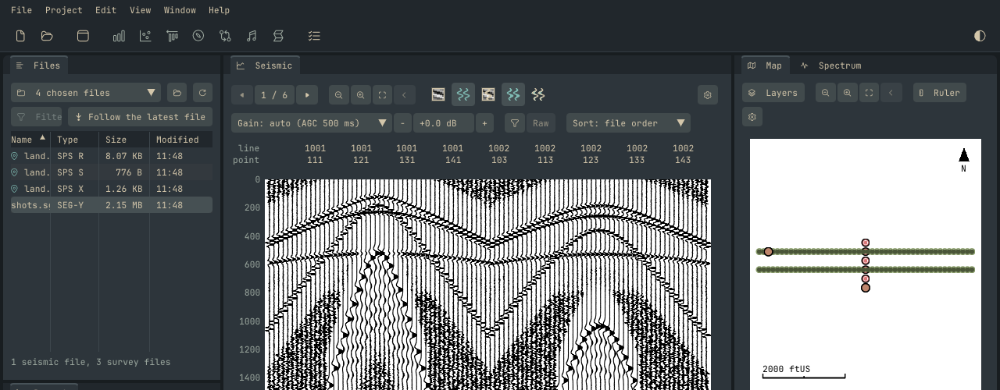

# viewSEG

A viewer for SEG-Y and SEG-D seismic data, with quality-control tools. It reads files
through [parseSEG](https://github.com/xrfez/parseSEG) and filters, gains and spectra
through [processSEG](https://github.com/xrfez/processSEG).



## Try it

Needs Nim 2.4. On a fresh clone, check out the pinned dependencies, build, and open the
synthetic land survey:

```sh
atlas rep atlas.lock
nim nimRelease
bin/viewSEG samples/land/shots.sgy samples/land/land.?
```

Record 1 of 6 opens (96 traces), and `land.s`, `land.r` and `land.x` go on the map.
What to do next is in `docs/user/QUICKSTART.md`.

## Building

Requires Nim 2.4.0. Dependencies are pinned in `atlas.lock` and checked out into `deps/`;
`nim.cfg` holds their search paths.

```sh
atlas rep atlas.lock    # fresh clone: check out the pinned dependencies
nim test                # compile the suite once, run each test on its own Xvfb display
                        # (a file that fails runs again alone: "flaky" if it then passes)
nim c -r tests/tfoo.nim # one file. Its checks are proc main*(), called only when
                        # the file is the main module. A file that must be its own
                        # program says ## Separate binary: <why> (tests/tester.nim).
                        # tests/tester.nim --separate compiles every file alone.
nim nimRelease          # build bin/viewSEG for this machine
nim winRelease          # cross-build bin/viewSEG.exe for Windows (zig)
```

SDL3 is linked statically, so neither binary needs an SDL library at run time. On Linux
its headers and `libSDL3.a` come from `pkg-config sdl3`. For Windows, `nim winRelease` first
cross-builds SDL 3.4.18 with zig (`tools/sdl3-windows.sh`: git, CMake, Ninja; once, into
`~/.cache/viewSEG/`, or `$SDL3_WINDOWS_PREFIX`). What makes the Windows build look and
behave like a Windows program (title bar, icons, tray), and what to check on a Windows
machine: `docs/windows.md`.

`nim depsCheck` verifies that `atlas.lock`, `nim.cfg` and `deps/` agree
(`tools/deps.nim`). `nim help` lists every task. The test suite also runs optional
checks on private files when a folder `exampleFiles/` exists (its untracked
`names.cfg` maps a neutral key to each file; `tests/privatefiles.example.cfg`
says what each key needs), and skips them otherwise.

## Packaging

`nim package` builds both release binaries (x86-64-v3, static SDL3; the Windows one as
`nim winRelease` does) and writes a self-contained folder and an archive for each OS into
`dist/`:

```
dist/viewSEG-<version>-linux-x64/      and  dist/viewSEG-<version>-linux-x64.tar.gz
dist/viewSEG-<version>-windows-x64/    and  dist/viewSEG-<version>-windows-x64.zip
  viewSEG | viewSEG.exe
  vendormaps/   vendor header maps (*.nif): parseSEG's and this repository's vendormaps/
  config/       settings; its presence makes the release portable
  assets/       themes, fonts (this repository's assets/)
  logs/         session logs
  licences/     viewSEG's licence and those of everything linked or bundled (see its README)
  docs/         README.md, QUICKSTART.md (docs/user/), BUILD.txt (commits it was built from)
```

The version comes from `viewSEG.nimble`. Running it again replaces the folders and
archives. It never reaches the network: the Windows SDL3 build must exist (run
`nim winRelease` once). `nim -d:packageTargets=linux package` (or `windows`) packages one
OS; `nim packageTest` packages, then checks `dist/` and runs the packaged Linux binary
(`tests/package/tpackage.nim`).

**Start-up smoke check.** Before a build goes out, `nim smoke` (`nim smoke new` for
`bin/viewSEG.new`, or `nim smoke <binary>`) starts the built binary, with no file, with
`samples/land/shots.sgy` and with `samples/land/shots.sgd` (`nim samples` writes them), and
checks that `--version` prints the three versions, that the program stays up for a few
seconds and answers on its agent interface (`state` names the file, and a screenshot of the
window is not blank), and that it leaves on Ctrl+C with exit code 0 and no "Internal display
error" or start-up failure in its output or log folder (`tools/smoke.nim`). It runs on a
private Xvfb display with a private home, XDG folders and agent socket, on a copy of the
binary in a folder of its own: it opens no window on the desktop and touches neither your
settings nor a running viewSEG. It needs Xvfb.

**Portable mode.** While `config/` next to the executable exists and is writable, viewSEG
writes everything (settings, `logs/`, `cache/`) inside its own folder. Without it, or in a
read-only location such as `Program Files`, it uses the per-user directories of the OS.
`viewSEG --paths` prints the directories in use and exits; `viewSEG --version` prints the
version; `viewSEG --help` lists the options. `viewSEG --reset-windows` starts with the
windows as at a first start and the main window on the primary screen, for when they are
arranged so that the menus cannot be reached (Window > Reset the windows, Ctrl+Shift+R, in
a running viewSEG).

## Agent control

An AI agent (any Model Context Protocol client: Claude Code, Claude Desktop, an editor) can
operate the running program while you watch: `viewSEG --mcp`, or File > Agent control, and
a client that starts `viewSEG --mcp-stdio`. Off by default, local only, every call shown in
Messages, nothing that writes a file, and what it changes is for that session only: your
saved settings and recent files stay as you left them. See `docs/agent-control.md`.

## License

MIT
