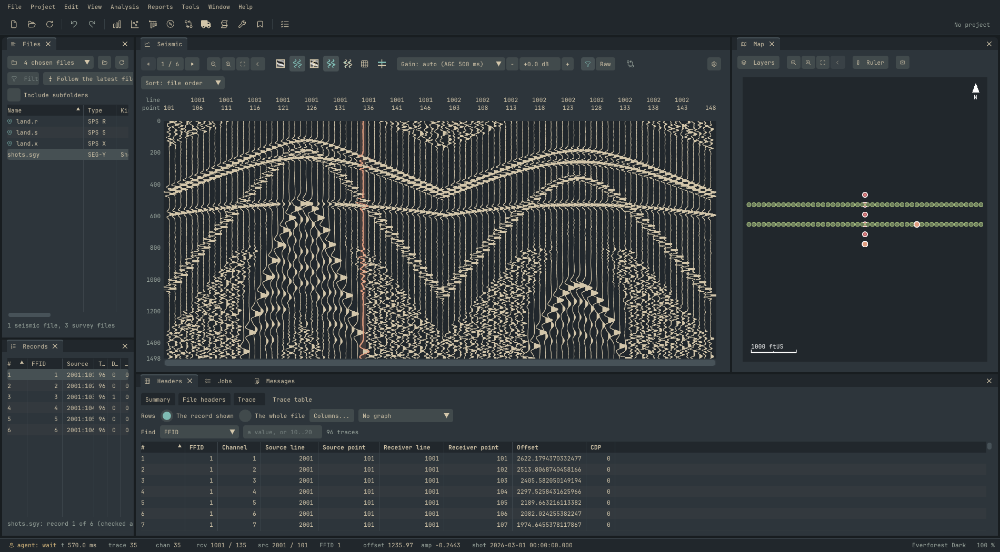
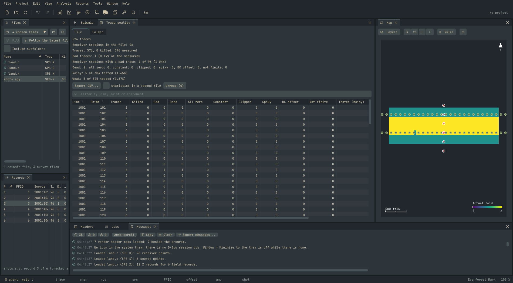
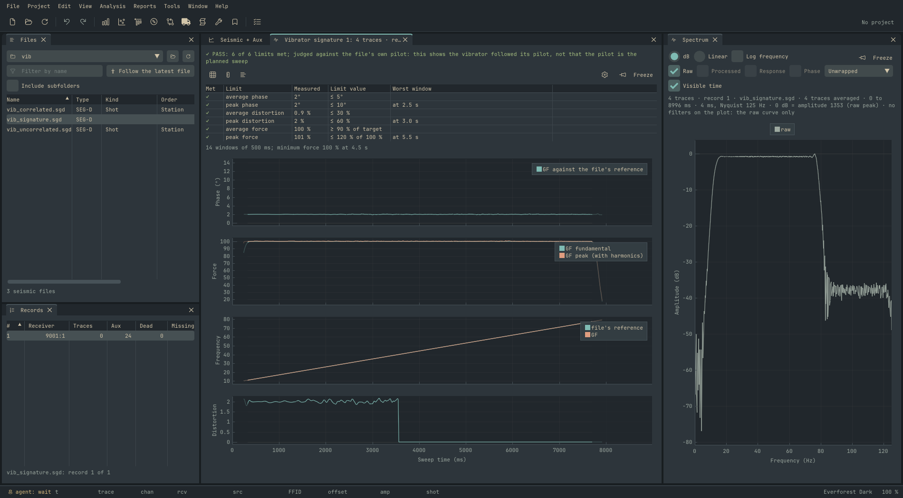
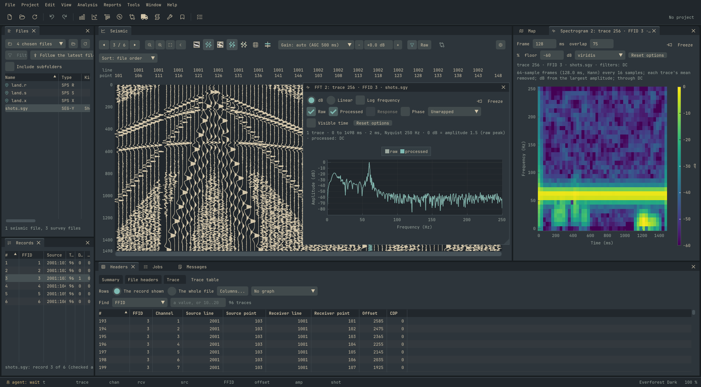

# viewSEG

**See what the crew recorded, and know whether it is good.**

viewSEG is a fast desktop viewer and quality-control tool for seismic field data. It opens
SEG-Y, SEG-D and SEG-2 files as they come off the recorder, puts them on the survey map,
and answers the questions a field QC asks every day: is every trace there, is it clean, is
it where the survey says it is, and did the vibrator do what it should have done?

## Why use it

- **It is built for the field, not the processing centre.** One small program, no
  licence server, no database, no installer. Unzip it on a laptop and open a file.
- **It is fast.** Records open as you step through them, including from a folder that is
  still being written or a slow network drive. Large files are read in the background and
  the window never waits for them.
- **It checks, and says why.** Every verdict comes with its reason in plain words and the
  limits it was judged against. Nothing is corrected silently: a reversed polarity or a
  moved station is reported as a finding, never hidden.
- **Your data stays yours.** Source files are opened read-only and are never changed.
  Nothing leaves your computer.
- **Free and open.** MIT licence, Linux and Windows.

## What it does

**Look at records.** Wiggle and density plots, gain, band-pass and notch filters,
sorting on any header, auxiliary traces in their own window, trace and binary headers
decoded with the vendor's own field names, and two traces compared sample by sample.

**Put them on the map.** Load the survey (SPS or SEG P1) and the plot and the map are
linked: click a trace to see its station, click a station to see its traces. The map
shows planned and recorded fold, missing shots and receivers, stations that have moved, and
first breaks that disagree with their neighbours.

**Judge a whole folder.** Missing traces, trace quality (dead, clipped, spiky, noisy, weak)
and vibrator performance are measured over every file in a folder, with a table you can
sort, a summary you can read at a glance, and a CSV for the daily report.

**Vibrator QC.** Phase, force, frequency and distortion for every sweep, judged against
the sweep the project planned and not only against the pilot the vibrator recorded. A
vibrator that sweeps the wrong band, stops early or runs with reversed polarity fails, and
the verdict says which.

**Spectra and analysis.** Amplitude spectra of any window of traces, live as you move,
plus correlation of uncorrelated vibroseis records and slicing of continuous recordings by
shot log.

## Where it is strong

- **Vibroseis.** Sweep QC against the plan, correlation, and continuous records.
- **Land and node surveys with a relation file.** Templates are respected everywhere, so
  a report counts the traces the survey asked for and names the ones it left out.
- **Mixed and awkward files.** Header maps for several recording systems ship with it,
  and you can add your own without rebuilding.
- **Honest numbers.** Raw amplitudes read in counts, volts or physical units from your
  sensor's data sheet, and a value viewSEG cannot stand behind is marked as unknown.

## Get it

Download the archive for Linux or Windows from the
[releases page](https://github.com/xrfez/viewSEG/releases), unzip it and run `viewSEG`.
Synthetic sample surveys are in [samples/](samples/), and the
[quick start](docs/user/QUICKSTART.md) walks through them.

To build it yourself, see [docs/building.md](docs/building.md).

## What is coming

viewSEG is released often. Next in line:

- Receiver gathers collected across a folder of shot files.
- Trace attributes on the map, with histograms.
- Signal-to-noise measurement.
- Rotation of node components.
- Printable QC reports.

## More

- [Quick start and user guide](docs/user/QUICKSTART.md)
- [Agent control](docs/agent-control.md): let an AI assistant operate the running program
  while you watch. Off by default, local only, and it cannot write a file.
- [Architecture](docs/architecture.md) and [building](docs/building.md)
- File reading is [parseSEG](https://github.com/xrfez/parseSEG); filters, gains and
  spectra are [processSEG](https://github.com/xrfez/processSEG).

## License

MIT
