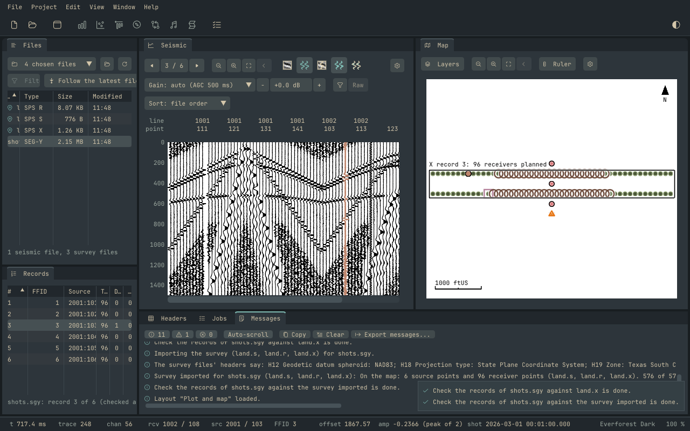

# viewSEG quick start

viewSEG is a viewer for SEG-Y and SEG-D seismic data with quality-control tools. It needs
no installation and no internet connection.

**Status:** early development. The window, the File menu, the file list, the folders
below, and one record on screen as wiggles or greyscale density, with zoom, pan, gain,
sorting, trace highlighting, killing and reversing traces, and a cursor readout, work.

## Start it

1. Unpack the archive anywhere you can write to: your home folder, a project drive or a USB
   stick.
2. Run the program in the unpacked folder:
   - Windows: `viewSEG.exe`;
   - Linux: `./viewSEG`.

It needs a 64-bit PC with AVX2 (Intel from 2013, AMD from 2017) and OpenGL 3.3.

If it cannot start, for example because the graphics driver has no OpenGL 3.3, a message
box says what failed, and the same text is saved as `startup-failure.log` in the logs
folder (`viewSEG --paths` shows where it is).

## Open data

**File** menu, or the shortcuts:

| Action | Shortcut |
|---|---|
| Open file... | Ctrl+O |
| Open files... | Ctrl+Shift+O |
| Open folder... | Ctrl+Alt+O |
| Close the file shown | Ctrl+W |
| Quit | Ctrl+Q |

The whole list, including the plot, the map and the tables, is **Help > Keyboard
shortcuts** (F1), and in [Keyboard shortcuts](keyboard-shortcuts.md).

**Right-click any plot and choose Explain.** A popover (Esc closes it) says what
that plot shows, what it is computed from (your filters, the reference, the units), how to
read it and what can mislead. The words for each plot are in
[What each plot tells you](plots.md).

**Project**, between File and Edit, holds this job's folder: **New project...** makes
one, **Open project...** and **Recent projects** open one, **Project...** opens its
window (ticked while it is open) and **Close project** goes back to working without one.
The toolbar under the menu bar repeats the menus' most used items, in groups set
apart by a thin line: Open file, Open folder and Reopen with options; Undo and Redo
(grey while there is nothing to undo or redo); a button for each plot of the selected
traces (enabled whenever a file is shown: with no trace selected, a plot opens
and says which trace to click), then the Reference archive; Jobs. Each has the menu item's name, and its
shortcut, in its tooltip.

The right end of the toolbar names the project that is open (its icon, then its name;
**(read-only)** when it is), or dim **No project** when none is. A long name is
shortened in the middle, and at a narrow window the name gives way and the icon stays.
Click it for the same items as the Project menu. Rest the pointer on it for the
project's folder and, in one line, how many survey files and data folders it holds. The
theme is changed from **View > Theme** and **View > Light / dark**, not from the
toolbar. **Analysis > References** keeps pilots and sweeps for the plots that need
one ([References](references.md)).

Files and folders can also be dragged from a file manager and dropped on the window.

A SEG-Y file whose binary header and first trace header both say 0 samples gives no trace
length, so a read of the rest finds its bytes cut into garbage traces. viewSEG refuses it when
what follows is not made of trace headers either, with one line in the Messages ("Cannot open
...: the binary header and the first trace header both say 0 samples per trace and what follows
is not made of trace headers, so the file looks damaged or is not SEG-Y"); it is not shown, and
nothing from it reaches the map or the Records table. A binary header of 0 with valid trace
headers (a variable-length file, one whose first trace is empty) and a headers-only file open
as usual.

**Survey files** (SPS source, receiver and relation files, `.s` `.r` `.x` or `.sps` `.rps`
`.xps`, and SEG P1 files) open the same ways: File > Open, a drop (several at once), the
command line. viewSEG tells them by what they hold, not by their name, and loads them into
the survey (on a job, with progress, in the Jobs window) instead of the Seismic window,
which stays on the file it shows. Messages says what each held ("Loaded land.r (SPS R):
96 receiver points.") and what was left out: records without coordinates or at (0, 0),
stations given twice (the last one is kept), damaged lines by number. A file that is not a
survey file, or a damaged one, is refused or read as far as it goes, and the program goes
on. Each open seismic file's source and receiver positions are read into the survey too,
and everything in the survey is drawn on the **Map** (below).

**File > Open recent** lists the files and the folders opened last (the start screen
shows the newest ones); the file dialogs start in the folder of the last file opened. Every file and
folder dialog (the Missing traces folder, the Output folders, the exports, the survey files and so
on) opens where that same dialog was last used, also after a restart, and falls back to the
nearest folder that still exists.

## Step through a folder

The folder listed last is remembered: in the project when one is open (it is listed again
when the project opens, in place of its data folder, if it is still there), else in your
settings (listed again when viewSEG starts), and File > Open file, Open files and Open
folder start in it.

A folder with no seismic files but with subfolders (a data folder with one folder a day, say)
is listed empty, and the Files panel says so under the list: "No seismic files here; 2
subfolders", with an **Include subfolders** button: click it, or tick **Include
subfolders** under the filter, to list the seismic files of every folder below the one chosen
too (not hidden folders; a folder that is a link is not entered, so a loop of links ends).
A Folder column then shows the path below the chosen folder (click its header to sort by it;
the filter matches it as it matches the name), and the listing runs in the background with the
count of files looked at so far and a Cancel button. A tree of more than 20 000 files is cut
there and the list says so. Follow the latest file works across the subfolders, and a
new file in a subfolder is listed. The switch is off by default and is kept in the project when
one is open, else in your settings. Or open one of the subfolders.

A vibrator controller's `.dat` and `.vib` signature files are listed with the seismic files, with
columns for the sweep (trigger, controller, vibrator and more), drop-downs for one controller or
vibrator, and a **Signature files** tick beside Include subfolders. Page Down in the Seismic
window steps from one sweep to the next, and **Open the .vib of this sweep** (and the `.dat`)
shows the other file of a sweep in the same window: see `signature-files.md`.

The **Files** window, at the left, lists the seismic files (SEG-Y, SEG-D, SEG-2) and the
survey files (SPS S, R and X, P1) of a folder with their type, size and date; other files
are counted at the bottom, not listed.
Opening a folder lists it and shows its first file; opening a file shows it and lists its
folder beside it. Listing reads only the first few kilobytes of each file, in the
background, so a folder of thousands of files lists without opening any of them.

The **Kind** column, after Type, says what each seismic file is as a recording: **Shot**,
**Continuous** or **Sliced**; the row's tooltip has the full words (shot gather, continuous
receiver gather, time-sliced receiver gather: the words the slice uses, see
`slice-by-shot-log.md`). It is worked out in the background, a file at a time, after the
listing, and never holds up opening or showing a file. A file up to 256 MB is read through its
trace headers only, never a sample, and the answer is the one the file gets when you open it. A
larger file is not opened for it, since a receiver that first appears late in the file can
change the kind and its start alone cannot tell: the cell shows **?** and the tooltip says "Open
the file to see its kind". A multiplexed SEG-D file is not opened for it either, since opening
it makes a demultiplexed copy of the whole file: its cell shows **?** too, and the tooltip says
it is multiplexed. Once you open the file the row takes its kind, worked out from the file's own
headers: the file as it was listed, before a survey join or station moves change its positions
(a joined file keeps the kind the list read). A file whose kind is not worked out yet, a file
that is not seismic and one without a live trace have an empty cell. Click the header to sort by
it. The **Order** column, after Kind, says how the traces of the file are written, told from
the same trace headers in the same read: **Station** or **Time** for a file of one component (also when the components are not
coded and so cannot be told apart: the tooltip then says the grouping cannot be told);
for several components, **Flag · station** or **Flag · time** (the components of a station or a
time together) and **Component · station** or **Component · time** (all of one component, then
the next); the tooltip says it in a sentence. An order holds only when every trace follows the
one before it of its component (a tie is fine), and components are never compared with each other; when no order
holds, the key never changes or the file has one trace, the cell shows **?**. A file that has
both orders (stations and times rising together) shows Station for a shot gather and Time for
a receiver gather. A shot gather is usually sorted by station only inside each record (the
station restarts at every record, so over the whole file only the time rises): when every
record is in order, with its components grouped alike in each, the cell says Station or
Flag · station and the tooltip says "Inside each record, traces are sorted by station."; a
record out of order, or stations that fall inside a record, leave it at Time. A trace placed by
its channel alone has no station order.

Right-click a seismic file's row to tell viewSEG what to treat it as. **Treat as** offers
Automatic, Shot gather, Continuous receiver gather and Time-sliced receiver gather; **Trace
order** offers Automatic, the grouping (None, By flag, By component) and the sort (By station,
By time). A tick shows what you forced. A forced value shows in its cell with a **\*** after the
word, and the tooltip says "Set by you" and what the file says on its own. It is remembered for
the file, by its content, so it follows the file when it is renamed or moved, and every part of
viewSEG that asks what the file is (the Files columns, the Headers summary, the slice by shot
log) goes by it. A file whose traces of a component all carry the same start time and that
you set to continuous is sliced taking each receiver's traces to follow one another end to end
from the time of its first trace; the slice says so, and a vendor header map that names each
trace's start time gives the real times. When the first trace has no start time at all, the
slice is refused and says to load such a map. The order you force is only shown for now. A choice an agent makes through the
command interface is for the session only. If several remembered documents could be the file's,
the choice is kept for the session and Messages says to open the file once first; until then the
list shows what the file says on its own, never a choice that may be another file's (the same
for a file touched or copied since the choice: its choice shows once it is opened). Two viewSEGs
with the file open keep each other's choice of the other parts: a choice sets only the part you
picked. The columns after Name are as wide as their words and Name takes the rest; when the panel is
too narrow for 16 characters of a name beside them, the list scrolls sideways. A folder listed
again in the same session takes the kinds already read and reads only the files that changed. A
file that changes on disk is read again once it is steady, and every kind is read again when the
vendor header maps change, since a start time may come from a vendor block.

- **Click a file** to show it in the Seismic window, in place of the one shown. The display
  (mode, gain, filters, sort order, display header) and the scales stay as they were, so records
  compare one after the other. **Click a survey file** to load it into the survey: a pin
  marks it once loaded (its tooltip says what it holds); the Seismic window stays as it is.
- **With the Files window focused** (click in it), **Up / Down** step to the next or
  previous seismic file and show it (survey files are passed by); **Page Up / Page Down**
  skip ten, **Home / End** go to the first and last. They do so wherever the focus is in
  the window, but in the filter box, which keeps its keys.
- **Tab / Shift+Tab** move between the window's controls, as in any window: the folder's
  drop-down, its two buttons, the filter, **Follow the latest file** and the list (one stop, at the file
  shown); **Space** or **Enter** acts on the control reached.
- **Filter by name:** type in the box over the table; only the files whose names hold
  every word typed are shown.
- **Sort** by any column: click its header (click again to reverse).
- The drop-down at the top lists the **folders opened before**; the buttons beside it open
  another folder and list this one again.

A file stepped away from is closed, so stepping through hundreds of files keeps one open.
Coming back to it is quick: its index is kept in the index cache (`viewSEG --paths`
shows where), so it is not read through again. The folder listed last is listed again at
the next start.

### Files that arrive while you look

The folder listed is looked at again about once a second, so files a crew or a copy
writes into it while you work appear in the list by themselves (no refresh needed):

- A file that **appeared** after the folder was listed is marked with a **dot** until you
  show it.
- A file whose size or time **changed** at the last look is marked with a **spinner** and
  its name is dimmed: it is being written. It stays listed, and you can click it to see
  what is there so far.
- A file that has stopped changing but **ends before its last trace** is marked with a
  warning sign: it is still being written (the writer paused), or it was cut short.
- The line under the table counts the new files and those being written.

By default the Seismic window **stays on the file you chose**. Turn on **Follow the latest file** (the
button beside the filter box, or **File > Follow the latest file**; it is remembered) to
show each new file as soon as it is completely written: its size has stopped changing
and it holds every trace it announces. A file still being written is never shown early;
each new file is shown once, so stepping back to an older one is not undone, and the
next new file is shown again.

**When the file shown changes on disk** (an acquisition system writes it again, or a newer
copy is put over it), viewSEG shows it again, as it is now, once it stops changing,
keeping the display, the record and the scales; kills and polarity reversals made on the
old file are set aside (Messages says so; Edit > Undo, Ctrl+Z, brings them back; they
stay remembered for the file as it was).
If the file was **cut short**, viewSEG stops reading it at once and says so in Messages.
On Linux and macOS one case remains: a file cut short by another program *while viewSEG is
reading it* (in the fraction of a second a pan, zoom or new record takes) stops viewSEG
with "Bus error". Do not copy over or truncate a file viewSEG is reading; copy the new file
in under a new name, or rename it into place (Windows does not let a program cut a file
another program is reading).

Looking costs little: a folder of 5 000 files is looked at in about 15 ms, on a thread of
its own; a slow network folder is looked at less often (ten times as long as a look
takes), and a folder that cannot be read for a while (a share that went away) is said
once in Messages and keeps its list.

### Files on a network drive

viewSEG never waits for a drive in its window: listing a folder, opening a file, reading
its traces and saving the settings all happen on threads of their own, so the window keeps
drawing, and every button works, however slow the drive is.

- **A drive that stops answering.** After 3 seconds without an answer viewSEG says so where
  you wait: in the Seismic window ("Reading shot12.sgd: not answering for 12 s"; the plot
  keeps what it showed), above the plot for a file being opened, and under the list in the
  Files window for a folder being listed or looked at. Each comes with **Cancel** (stop
  waiting: the picture stays as it is) and **Retry** (try the drive again). The status bar's
  job says it too. Meanwhile you can show other files, from other folders or drives.
  The **Headers** window says it above its tabs ("Reading shot12.sgd for the Headers
  window: not answering for 5 s") and keeps what it showed; pointing at a trace of another
  file reads that one meanwhile.
- **A drive that goes away** while a file is shown: the plot keeps the picture, and
  Messages says once that the drive is not answering; Retry reads again once it is back (a
  file read through a map is opened again by Retry: a read that failed keeps that file
  unread until it is). A file on a network share is read unmapped, so its failed reads
  are simply read again. The Headers window says so for a trace or a record it could not
  read; a file whose own headers could not be read as it was opened is open without
  them, and its Summary says why.
- **A file cut short while it is open** (another program truncates it, or writes it
  again): viewSEG goes on. The traces before the cut are drawn as they were; those past
  it are drawn blank, and Messages says once, in words, that the file was cut short and
  that opening it again shows what it holds now. The Headers window, an FFT window and the
  other windows that read the file say the same for what they could not read, and the
  folder's watch opens the file again once it stops changing.
- **Quitting** never waits for a drive: the window closes within about a second, whatever
  is stuck. A read the drive still holds is left to end on its own.
- **A slow drive.** viewSEG times its reads; when they are slow it reads further ahead
  (three views on each side instead of one and a half) in larger reads, so panning finds
  its data on hand more often. **File > Prepare the next file** (on by default) opens the
  next file of the list in the background while you look at one: its index, and the
  samples of its first view, so the next step does not wait for the drive to be walked.
  Files larger than 2 GiB are not prepared.
- **The index cache** stays on your own disk (in the cache folder, `viewSEG --paths`),
  never beside the files, so a second visit to a file reads its index locally.
- **What can still stop viewSEG:** nothing a file or its drive does while it is open.
  A file cut short or a drive that fails fails the reads that need what is gone, not the
  program (parseSEG's guard on its memory maps; on Windows a mapped file cannot be cut).
  A hung read, as on a share that stops answering, holds only the thread that made it.
- **On Windows, close a file before another program replaces it.** While viewSEG shows a
  file on a local disk, Windows lets another program add to it or delete it, but not
  overwrite it, cut it or rename another file over it: close it in viewSEG first (or
  reopen it unmapped with **Reopen with options...**, which allows an overwrite but still
  not a rename over it).

## Step through the records of a file

A file often holds several records (shots, receiver gathers, CDPs). The Seismic window shows
one at a time; the **Records** window, under the file list, lists them all, one row each,
with what tells them apart (a shot's FFID and source station, a receiver gather's
receiver, a CDP), and its key information: its seismic **Traces**, its auxiliary traces
(**Aux**, when the file has any), the traces the file marks **Dead**, and the traces
**Missing** from its patch. Missing counts against what the file itself declares for the
record (a SEG-D record's seismic channel sets, a SEG-Y file's traces per ensemble) and,
once the survey's relation file (SPS X) is loaded, or imported for the file (Project >
Import survey, below), against the stations its X record plans for the shot; the cell's
tooltip says which, and how many of the record's traces are at stations the plan does
not list. A record with traces missing is drawn
in the warning colour, and the footer counts them; where nothing says how many traces a
record should hold, the cell is empty, as it is for every record of a file whose traces
are all auxiliary (there are no seismic traces to miss). The record shown is highlighted. Click a column's
header to sort by it (again for the other way; **#** is the file's order): sorted by
Missing, the short records come first.

- **Click a record** to show it. With the Records window focused, **Up / Down** step to
  the next or previous one in the order shown, **Page Up / Page Down** by a page,
  **Home / End** to the first and last. A file of a hundred thousand records scrolls as
  lightly as one of ten. Tab steps no record (the list is the window's one control).
- **In the Seismic window:** **Page Down / Page Up** show the next or previous record,
  **Home / End** the first and last; the arrows in the strip do the same, and the number
  between them ("2 / 120") opens **Go to record** (also **Ctrl+G**): type a place in the
  file or a field record number (FFID) and press Enter.

The next record is shown at the same scales (the same traces and times in view, or the
whole record if the whole one was in view before), with the same gain and trace order,
so records compare one after the other.

## Missing traces

**Reports > Missing traces...** lists the stations the survey's relation records call
for that a file does not hold. It needs relation records (X records) imported; without
them the window says so in one sentence and shows no table. A shot gather is checked
against the X record of its shot (the receiver stations expected). A receiver gather is
checked against the O record of its receiver (the source stations expected); when no O
records are loaded they are worked out from the X records. When several X records share
the shot's source station, the record (file) number does not choose between them: the
shot is checked against each and takes the one whose receivers it holds the most of, and
of those the one it lacks the fewest of. X records that call for the same receivers (a
reshoot of the same patch) count as one. When two X records with different receivers fit
the shot equally on both counts, it is listed under **Unmatched**, as only the record
number could tell them apart.

The File tab checks the file shown only while it is in sight (not behind another tab, nor while the Folder tab is on), says nothing in Messages and raises no pop-up when it finishes, and does not check a vibrator signature file (`.dat`, `.vib`); the Folder tab's **Run** still announces its end.

Which of the two a file is: a continuous receiver recording is not checked. Otherwise the
stations in the trace headers decide. Several receivers and one source is a shot; one
receiver and several sources is a receiver. One receiver and one source can be either a
single shot slice or a shot that only one receiver recorded, so the other files of the
folder decide: it is checked the way most of the files that could be told were. A file
on its own (the File tab), or a folder of nothing but such files, is taken for a slice.
When the traces hold several sources and several receivers, the recording kind the
program shows for the file decides (shot gather or time-sliced receiver gather); when that
cannot be told either, each record of the file is judged on its own, and one that is
neither one shot nor one receiver is listed under **Unmatched** with the reason.

A receiver is checked once, over all its traces: in a file, however many records (one
for each shot slice) its traces are cut into, and on the Folder tab across every file of
the folder, so a folder of one file for each slice, of one file for each receiver, or a
mix of the two, gives the same answer. For receivers the window counts receivers, not
records, and **Missing** for a source is the number of receivers that lack it. A receiver
with two O records is checked against the sources of both at once: the record number
does not choose between them. Traces of one receiver point with index 0 and index 1 are
one receiver; the index makes two receivers only where the survey has the point at two
indices.
A record is never matched to the survey by its record (file) number alone: one whose trace
headers hold no source station (no receiver station, for a receiver gather) is not checked
and is listed under **Unmatched**.
A continuous receiver recording is not checked, and the window says so; a file with one
live trace, or the components of one station, has nothing to judge continuity by and is
checked.

A station is one line and point, however many components it has: a station with three
or four components is one station, and it is present when any of its traces is in the
record.

The **Missing traces** window stays closed until you ask for it. It opens as a tab beside
the **Seismic** window; its close button (or the View menu) hides it, and opening it again
keeps the place you last gave it. It has two tabs.

- **File** checks the file shown in the Seismic window, as soon as the window is drawn,
  and again when another file is shown. Above the table are the figures, one to a line:
  which stations are expected and by which records ("Receiver stations expected by the X
  records"), how many are in the template, how many are found in the file, how many are
  missing, and the percent of the template missing. A file with several records also has
  a line that counts per record (each station once for each record that calls for it:
  expected, present, missing, percent). The table has the columns **Line**, **Point** and
  **Missing**: how many records of the file call for that station and do not have it. The
  file is read from disk, so killed traces and other edits of the session count as
  present; the tab says so when the file has killed traces. A file that holds one shot
  slice of one receiver is checked as that receiver, so the receiver's other shots show
  as missing; the tab says that they are in other files and that the Folder tab checks
  the receiver as a whole.
- **Folder** checks the files of a folder you choose, and does nothing until you press
  **Run**. **Folder...** opens the folder dialog and the chosen path is shown and kept for
  next time. **Include subfolders** is off until you tick it; changing the folder or the
  tick drops the answer on screen. The figures are the same, added over the files, and
  **Missing** goes up by one for every shot record (for receivers, every receiver) that
  lacks the station.

While a check runs, a progress bar and **Stop** show; the Jobs window lists it too.
**Skipped** lists files that were not seismic or could not be read, **Unmatched**
records that have no relation record to be checked against, and (Folder tab) **Not
checked** the continuous recordings. A box narrows the rows by line or point. Click a
column header to sort by it (again for the other way; Shift-click adds a column).
**Export CSV...** writes the rows of the table on screen (`line,point,missing`): with
words in the filter box, only the rows they let through. **statistics in a second file**
also writes the figures of the whole result beside it, with `-statistics` before the
extension and the filter text in its last column.

## Trace quality

**Reports > Trace quality** measures the traces of the file shown, or of the files of a
folder you choose. The item is always active, and opening the window computes nothing on
a folder: the **File** tab measures the file shown in the main window (it follows the
file, and measures it again after a kill or an undo), and the **Folder** tab does nothing
until you press **Run**.

The **Trace quality** window stays closed until you ask for it. It opens as a tab beside
the **Seismic** window, and that tab is the one in front. The close button on its tab (or
**View**, the window's entry) hides it and stops what runs; the entry brings it back where
you last left it.

**Folder** takes the folder from **Folder...** (remembered, with the **Include
subfolders** box, which is off until you tick it). Only the files of the folder itself are
measured unless the box is ticked; changing the folder or the box drops the answer, and
**Run** measures again. A run is a background job with its progress bar and **Stop**.

Under the tab's own controls come the figures, one per line: the stations measured, the
traces (read, killed, measured), the bad traces and the stations with one, each finding
(**Dead**, **All zero**, **Constant**, **Clipped**, **Spiky**, **DC offset**, **Not
finite**), the noisy and the weak among the traces tested for them, each with its percent,
and, when a file has more than one component, how many stations lack a component (in at least one file). The
stations are the receiver stations of a shot gather's traces, the source stations of a
receiver gather's (the rule the Missing traces window uses for a file); when a folder holds
both, **Receiver stations** and **Source stations** choose which are shown. A killed trace
is counted as killed, not as bad, and it is not measured.

The table has one row per station (line and point), whatever its components and files: a
station's traces in every file measured count in its one row, so on the Folder tab the
counts add up across the files. **Traces** counts the traces of the station (killed ones
included), **Killed** and **Bad** the killed and the bad ones, then the count of each
finding. **Lacks component** and **Files lacking** (shown when a file has more than one
component) are judged file by file: in a file, a station that has a trace there lacks the
components that file has at other stations and it has none of. The first column lists the
components lacked in any file, the second counts the files in which the station lacked one
(it adds up across the files of a folder). A file of one component flags nobody. The last counts, **Noisy** and
**Weak**, are the traces the map's noisy and weak filters show for each field record,
found the same way (the exclusion area you chose in Tools > Settings applies, and a
record's first breaks are found for it, so a scan takes longer). They are not counted as
bad. Each comes after the traces tested for it, **Tested (noisy)** and **Tested (weak)**: a
trace inside the exclusion area is tested for weak but not for noisy, as on the map.
Killed, dead and auxiliary traces, a record that could not be read and one the test cannot
judge are tested for neither. A Noisy or Weak cell is empty where no trace was tested for
it. The scan judges the samples as recorded, with your kills and noise settings, but
without the per-trace filters, reversals, shifts or template-only restriction the map
applies to the record shown. Every column header has a tooltip that says what it counts.
Nothing is looked up by a record number, and the table has no column for one.

A box above the table narrows the rows by line, point or component; each tab keeps its own. Click a column header
to sort by it (again for the other way; Shift-click adds a column). The sort's place is a
small number after the header name. When a file or a trace could not be read, a line says
how many; **Unread** opens that list, each with the reason.

**Export CSV...** writes the table, only the rows the filter leaves in sight.
**statistics in a second file** also writes the figures beside the one you save, with
`-statistics` before the extension.

## Vibrator QC of a folder

**Reports > Vibrator QC of a folder** judges the vibrator signature files you choose, with
the project's vibrator QC configuration. The item is always active; nothing is listed or run
until you choose a folder or files and press **Run**.

The **Vibrator QC** window stays closed until you ask for it. It opens as a tab beside
the **Seismic** window, and that tab is the one in front. The close button on its tab (or
**View**, the window's entry) hides it; the entry brings it back where you last left it.

The window asks for no setting. A line at the top shows the configuration in force, as
text: the reference measured against (the project's chosen reference, else the one stored with
the profile, else each file's recorded reference), the file it was configured from, the
statistics window, the harmonics, the accelerometer set, the force scale, the 100 % force and
drive level, the top frequency and the limits, and the job's weights when set. You set all of
this in a Vibrator signature window (**Analysis > New plot > Vibrator**, on a signature file):
it is kept in the project as you set it, with no button. With no project, or with nothing set
yet, the window says only "Vibrator signature QC is not configured." and where to set it, and
**Run** stays inactive. The job's three weights (hold-down, baseplate, reaction mass) are in that
window's settings wheel.

The reference line says which is in force: a stored sweep ("Reference: <name> (a stored
sweep)"), or each file's own recorded reference, which is what you get when you choose a
reference that is a trace of the record ("<name> is a trace of the record") or none at all.
When the chosen stored reference is not in the archive, or the references are still being
read, the window says so and **Run** waits; to measure against each file's recorded reference,
choose a reference that is a trace of the record (**Analysis > References**).

The **Files** tab picks what to run. **Folder...** opens the system's folder dialog;
**Include subfolders** (off at first) also takes the folders under it. **Files...** opens the
system's file dialog for single signature files. What was chosen is shown, and the signature
files found are listed, each ticked, with how many are ticked ("3 of 3"). **All** ticks every
file; **None** clears the ticks. Untick a file to leave it out. The choice is kept while the
program runs.

The **Results** tab is one row per file that was run. The columns are File (the name; the
full path is in its tooltip), Electronics number, Vibrator number, Time (UTC) (the sweep's trigger
time), FFID, Source line and Source point from the shot log, then Kind, Pair, the verdict, the
sentence, the measures, the polarity, the warnings and any problem. A `.vib` takes its `.dat`'s
electronics number, vibrator number and time. FFID and the source line and point come from the
loaded shot logs, matched with the sweep as the Shot log window matches a signature; a sweep no
log has stays empty, and with no shot log loaded the window says so above the table. The File
column fits the names shown. The sentence column takes the width left in the window; a cell
that is still cut off shows its full text when the pointer rests on it. Click a row to read its
sentence, warnings and problem on the lines under the table. A file that could not be judged
puts its reason in the sentence column. A box above the table narrows the rows. Click a column
header to sort by it (again for the other way); Warnings, FFID and the source columns do not
sort. The totals count the whole run, not only the rows the filter leaves in sight.
The configuration text above the results is the one the run used; when the settings differ
now, a line says so. A chosen file that cannot be read, or is no signature file, is listed with
that problem; a chosen folder that does not exist says that it could not be listed. In a
project opened read-only, the window says that the QC settings cannot be kept in it.

Every file gives its own 100 % force where it can: a `.dat` from its target force (needs the
counts-per-pound scale and the drive level), a `.vib` from its header's hold-down weight (needs
the accelerometer constant). A file whose force limits could not be judged says which piece is
missing in its warnings, its Verdict reads "pass (force not judged)", the totals say "N with
force not judged", and a line above the table says that some force limits were not judged.

**Run** lists nothing new: it judges the ticked files. Listing and judging are background jobs
with progress; while it runs, the button is **Cancel**. When it finishes, the **Results** tab is
the one in front. **Copy** puts the whole table on the clipboard. **Export CSV...** writes the
whole table, with the same columns, not only the rows the filter leaves in sight. Double-click
a row to open that file.

## Output

**File > Output...** writes the seismic files of the folder open in the file list, including
the folders under it, as SEG-Y or SEG-D. The item stays in the menu. It is inactive until
a folder is open.

The **Output** window stays closed until you ask for it. It opens as a tab beside the
**Seismic** window, and that tab is the one in front. Closing it and opening it again keeps
the place you last gave it. When the main window is wide, the source is the left pane and
the write is the right, sharing the height; drag the splitter between them. Below about
900 px of the main window's width the panes stack, the source above the write.

The left pane is the source. **Change source...** picks another folder. **All**, **None**
and **Only the shown file** set the ticks. The filter box narrows the tree by file name.
The tree lists that folder's seismic files, including a vibrator signature file,
and fills the pane. A folder shows how
many of its files are ticked, and the line under the tree is the total and its
size. Tick the ones to write.
**All** and **None** cover every listed file, including ones the name filter hides.
**Only the shown file** ticks the file the Seismic window shows, and no other. A folder's
box is mixed when only some of the files under it are ticked; a click then ticks them
all. Ticks are not kept.

The right pane is the destination and the write. **Change destination...** picks the
folder to write into. **Format** is SEG-Y or SEG-D. **Revision** under it is **Same as
the source** or one revision of the format. Same as the source: a SEG-Y file keeps its own
revision and headers, a SEG-D file keeps its own revision, and a file of another standard is
written as SEG-Y Rev 2.1 or SEG-D Rev 3.0. SEG-Y offers Rev 0, 1, 2.0 and 2.1 for every
source: the headers are rewritten as that revision, and the notes list what it could not
keep (extended text, trailers, a time that was rounded, and so on). SEG-D offers Rev 3.0
and 3.1 only when no ticked file is SEG-D, as a SEG-D file keeps its own revision; a
folder that mixes standards offers the choices that hold for all of them, and a line says
what each file gets. The choice is remembered for each format; one the ticked files cannot take is shown as Same as the source for that write, and is not forgotten. The boxes under it, in two columns,
are on: polarity reversals, dropping killed traces, each trace's own filter, time shifts,
and the plot's sort. **Processing**, the Seismic window's filters, is off every time you
start the program, so a band-pass on the plot is never written unasked. Tick it and a line
under the boxes says what will be written (for example "The written traces will be
filtered: band-pass 5-10-40-60 Hz."), or that no filter is on; each
file's notes say the same. **Keep the file's own positions**
is off: a survey join or a station move in an open file is written into the headers on
every path, including when headers are built from the trace keys. The notes say how many
traces changed, or that the positions were written where the format has a place for them,
or that they could not be written. Tick it to write the file's own positions from its
header keys; the notes say so. A file the batch opens itself
takes the project's survey join and station moves, for its own traces, as an open file
does, and the notes say so; a file the survey does not cover is written with its own
positions, and the notes say that.
Display-only gain is not written.
A SEG-D file is sorted within each record. A file already open is written as it stands,
including edits not yet saved. A signature file that is not open is decoded and
written the same way; one that cannot be decoded is a failed row, and the rest
are still written. Two signature files whose names differ only by `.dat` and
`.vib` keep that extension in the output name, so they are not written as one
file. An open vibrator signature file written as SEG-D, with none of those boxes
on, keeps its own header block and channel types; a survey join's positions are
not in those bytes, and the notes say so. With one of those boxes on, the notes
say that header block is not carried, and the position tick is the same as for
any other file. **Keep the sub folders** is on:
a file in a sub folder is written in that sub folder.

**Run** writes every ticked file. It stays inactive, and says why, when nothing is
ticked or no destination is chosen, and when the destination is the source folder,
inside it, or holding it. While the write runs, the button is **Stop** and the line beside it says
which file is being written. **Stop** finishes the file in progress and skips the
rest; the line then says **Stopped.** The line above the table is the total (written,
failed, skipped). The table is one row per file: the relative path, the outcome (and
the reason when it failed), how many traces were written and dropped, and the notes.
Columns can be resized. **Copy results** puts that table on the clipboard. **Export log...**
(dim until a run has finished or was stopped) asks where to save a text file, by default
`viewSEG-output-<date>-<time>.txt` in the destination folder, and writes it in the
background, so a slow disk does not stop the window; if it cannot be written, Messages
says why. The file holds when the run was, the source and destination, the options in
force (format, revision, every tick, the reference of a correlated run, the sort, the file
names, the header templates), the totals, and for every file, in file order, where it was
written, the result, its size, the traces written and dropped, and all its notes, not only
what the table has room for. A stopped run lists the files it skipped. **Open
destination** opens the folder.

**File names** (above **Format**) names each file from its own values instead of its
source name: see [Output file names](output-file-names.md). **Text header** (SEG-Y only) writes each
file's text header from a template of the project: see [Text header](text-header.md). **Binary header** (SEG-Y only) sets chosen fields of each file's
binary header from a set of the project: see [Binary header](binary-header.md).
**Correlated** writes the
files correlated with the project's reference: see [Correlate](correlate.md).

## Jobs

Anything that takes a while (opening a large file, listing a folder) runs while you go
on working. The status bar shows the job running, how far it is and the time left, with
**Cancel**; click it (or the toolbar's Jobs button, or **View > Jobs**) for the
**Jobs** window, which lists every job:

- **Running:** a progress bar for each, with Cancel.
- **Waiting:** in the order they will run, in two lanes: *foreground* for what you are
  waiting on (opening a file) and *background* for long work, so a long job never holds up
  an open. The arrows move a job up or down its lane; the bin takes it off the list.
- **Finished:** how each ended (done, failed and why, cancelled) and how long it took;
  *Clear the list* empties it (Messages keeps the record).

When a background job you started ends, a short notice appears in the bottom-right corner
for a few seconds; click it for the Jobs window. Work the program starts by itself (the check
of a file's records against the survey as the file opens, the preparation of the next file)
gives no notice and no "is done" line when it went well; a failure still does. A file whose
traces are all auxiliary is not matched to the survey or checked against it, and its headers'
units do not count in the units judgement.

## Look at a record

An opened file shows its first record in the **Seismic** window (a window is named for
what it shows): traces across, time down, as
black wiggles with their positive lobes filled, on white paper, with automatic gain (AGC
on shot and receiver records). Wiggles stay wiggles at every zoom: zooming out stops
where the traces are one pixel apart, so every trace in view is drawn. A shot of more
traces than the plot is wide (a few thousand, say) opens at that limit from its first
trace, with a scroll bar under the plot for the rest. To see a whole large record at
once, choose the density display (Greyscale density, in the strip), which zooms out until
the record fills the plot. Where the traces are only a few pixels apart, the wiggle line
is drawn thinner than a pixel (light grey), so the fills show the record as a
variable-area section rather than a band of lines. In wiggles the plot reaches a little past the first and the
last trace, as far as their swing goes (the trace overlap), so their whole wave shows; a
record of a single trace shows whole. The rows of labels over the traces are the display header (receiver line and
point by default): right-click them, or their names at the left, to choose its fields
(automatic, or the ones you tick); the gear button has the same choice. Two rows are never
on until you tick them: **channel set** (SEG-D: the trace's channel set and its type, "2 · seismic",
to tell the traces of a record of auxiliary signals apart) and **trace ID code** (SEG-Y: the
code in words). A type parseSEG has no name for is shown as its code.

Under the fields, **Vendor fields** lists the fields of the vendor header maps that the
shown file has (see `vendor-maps.md`; Tools > Reload vendor maps loads the maps again). Tick a
numeric field to show it as a row of the display header, over the traces, untick it to take
it off: a trace that has no value for it shows a blank, never 0, and a record-level field shows
its record's value on each of its traces. Fields that hold text are listed but cannot be ticked
(a row shows numbers), and so is a field of a repeat; the tooltips say why. A field is named by
its own name, or `block.name` when two blocks have a field of that name, or when its name is also
a built-in row's. A field you have ticked that the shown file does not have stays listed with
"(not in this file)", so you can untick it. A list of more than 25 fields has a filter box. The
header has at most 32 rows: at the most, the fields not ticked are dimmed. The fields are listed
in the background: the submenu says "Reading…" until they are known, and "No vendor fields"
when no map applies to the file.

| To | Mouse | Keys |
|---|---|---|
| Zoom in or out about the pointer | wheel | `+` / `-` |
| Zoom up and down only (time; the traces when time runs across) | Ctrl + wheel | Ctrl + Up / Down |
| Zoom across only (the traces; time when it runs across) | Shift + wheel, or the sideways wheel | Ctrl + Right / Left |
| Pan | drag with the left or middle button | arrows, the way they point (a tenth of the view; with Shift, a whole view) |
| Pan with a scroll bar | drag its thumb; click the bar for a whole view; or the wheel over it | |
| Zoom to a box | drag with the right button | |
| Fit the whole record (in wiggles: as far as one pixel a trace, from the first) | the fit button | Ctrl+0 |
| Go back to the view before | the back button | Backspace |
| Step the selection to the next or previous trace | | Alt+Right / Alt+Left (Alt+Down / Alt+Up when time runs across) |
| Select a trace | click it | |
| Add a trace to the selection, or take it out | Ctrl + click | |
| Select every trace from the one clicked last to this one | Shift + click | |
| Cancel a drag, else clear the selection | | Esc |
| Kill or restore the trace under the pointer (the selection, if it is in it) | right-click: Kill / Restore | `K` |
| Reverse its polarity, or put it back | right-click: Reverse polarity | `R` |
| Its amplitude spectrum (the selection's, averaged, if it is in it) in a window of its own | right-click: New plot > FFT | `F` |
| Copy the trace under the pointer into a compare slot (one trace, even if several are selected) | right-click: Compare > Set as A / Set as B | |
| Undo the last kill, restore or polarity change | Edit > Undo (or right-click: Undo) | Ctrl+Z, in any window |
| Redo what was undone | Edit > Redo (or right-click: Redo) | Ctrl+Shift+Z or Ctrl+Y, in any window |
| See the traces without the filters, or filtered again | the strip's Raw toggle | `P` |

Keys act while the Seismic window has the focus: click in it first (undo and redo work
from every window, but in a text field, which keeps its own Ctrl+Z). The click that brings
a window forward does only that: it selects no trace, and in Files or Records it shows no
other file or record; click again to do so.

A new size of the Seismic window (its edge, the windows beside it, the main window) keeps
the scales and the top-left corner: what no longer fits is reached with the scroll bars,
and a larger window shows more. Only a window larger than the whole record at that scale
shows it larger, filling the plot.

**Display.** The display buttons in the strip choose how traces are drawn:
density, wiggles, or wiggles over density. Density is drawn only in the two modes that
name it. Changing from density to wiggles while more traces are in view than the plot
has pixels narrows the view to one pixel a trace, keeping its left edge. In the two wiggle
modes, the two after them fill the wiggles' positive
lobes (right of the trace; above it when time runs across) and negative lobes (left of
it; below it): either, both or none. In density those two are not drawn. **Overlap**, in
the gear's Traces tab, sets how far the strongest amplitudes swing a trace, in trace
spacings (1 reaches the next trace; anything stronger is clipped there): type a value, or
step it with - and +. It is greyed in density. The gear also holds the
**colours**: a swatch for each of the plot's six colours (background,
wiggle line, positive fill, negative fill, the trace under the pointer, selected traces),
always shown. Click one to pick a colour, or type it as `#rrggbb` and press Enter: the
plot becomes "My own" colours. **Paper** (black on white; negative fills red) and
**Follow the theme** put ready-made colours back; **My own** brings yours back. They are
remembered when you quit. Under them, **Density colour map** shows each map as its colour
bar: **Grey** (positive black), **Red-white-blue** (negative red, zero white, positive
blue), **Viridis** (dark purple to yellow) and **Red-black** (negative red, zero white,
positive black); click one and the density is drawn in it at once.

**Display presets.** The gear's Look tab keeps whole displays under names, under its own
**Display presets** heading below the Plot checkboxes: type a name and click **Save** to
keep the display shown (mode, fills, overlap, colours, colour map, gain and its settings,
clip); click a preset's name to draw the plot that way again (it stays turned as it is).
**Rename** and **Delete** act on the preset you clicked last. The presets are remembered
when you quit.

**Auxiliary traces.** When the record holds auxiliary traces (a time break, a pilot, an
uphole), two toggles in the strip choose what the plot shows: **Seismic** (on at first)
and **Aux**. With both on, the auxiliary traces stand in the file's order among the
seismic ones and the window is called **Seismic + Aux**; with Seismic off it shows the
auxiliary traces alone (**Aux**). One of them always stays on. The choice is remembered,
as the gain and the sort are: the next file, a new plot and the next time you start
viewSEG show the same traces, when the file has them. A file with no auxiliary traces
shows its seismic traces and leaves that choice as it was. The gain, the sorts, the
edits, the display header and the status bar work on them too.

**The Aux window.** To see the auxiliary traces beside the seismic ones, open **View >
Windows > Aux** (ticked while it is open; it is closed at first). It docks to the right of
the Seismic window, taking 30 % of its width, and shows the auxiliary traces of the record
the Seismic window shows, as wiggles
with a gain of their own, and follows it: the next record, another file, "Follow the latest
file" and a reload. A record with no auxiliary trace says so in one line ("This record has
no auxiliary traces."). When every auxiliary trace is killed and killed traces are hidden,
it says "Every auxiliary trace of this record is killed and hidden." Its strip has the
zoom and fit buttons (the view is its own: the time range is not tied to the Seismic
window's), the **positive** and **negative fill** buttons, and the gain: **None**, **Fixed**
or **Normalized** (Normalized for each trace at first: a pilot and a monitor channel can
differ by orders of magnitude) and the gain amount. It starts with a red wiggle line and
positive fill and a black negative fill; the Seismic window stays black on white, and a
choice you already saved is kept. The gear holds the **Look** (colours,
the cursor time line, time across) and **Traces** (trace overlap, killed traces, the display
header's rows) tabs. It has no record buttons, filters, sort, template or first-break
buttons and no Seismic / Aux toggles: those belong to the Seismic window, which keeps its
own Seismic and Aux toggles. Its right-click menu is the Seismic window's without the Map and
Whole record groups and without the plot's filters: reverse polarity, kill or restore, New
plot (FFT, ...), Compare, Store as reference, Undo, Redo and Explain. A click on a trace
there selects it as in the Seismic window: the plots, the Spectrum, the Vibrator window, the
status bar and the Headers window follow that selection. A kill or reversal made there is the
file's edit, so the Seismic window shows it too (with Aux on). The window's display, gain and
header, whether it is open and where it is docked are remembered when you quit.

**Filters.** The **Filters** button in the strip (a funnel, after the gain; lit while
filters are applied; its tooltip and the top of its drop-down say which) sets what the
traces go through before the gain, and the plot follows each number
you set:

- **DC removal**: none, the mean, or the mean and a linear trend of each trace.
- **Pass band**: none, **Low-cut**, **High-cut** or **Band-pass**, each by its corners in
  Hz: the low-cut ramp from f1 (nothing below) to f2 (everything above), the high-cut ramp
  from f3 to f4 (nothing above). A band-pass of 8-14-60-80 Hz, say, takes the slow ground
  roll out of a shot record. Type each corner in Hz into its box and press Enter, Tab or click away: it
  is taken exactly as typed. A number that cannot be there (a corner past its neighbour or
  past the file's Nyquist frequency) is refused, with a line in the drop-down saying where
  it may be. A corner past Nyquist set for another file is cut there, and the drop-down
  says so.
- **Notches**: **+ 50 Hz** or **+ 60 Hz** adds a notch at the power line's frequency and
  its next two harmonics (x3); **+ Notch** one of your own. Each has its frequency, its
  width (the notch is gone half the width away) and how many harmonics it takes, and can
  be turned off or removed.
- **Filter the Aux traces too**: off, the auxiliary traces are shown as recorded; on,
  they go through the same filters (a notch on a pilot sweep shows where it passes that
  frequency).
- **No filters** takes them all away.

The **Raw** toggle beside the drop-down (or `P`) shows the traces without the filters,
under the same gain, so you can compare; press it again for the filtered traces. The
filters stay on for the next record and file, and a new plot starts with the ones you
set last. Changing a corner never reads the file again: viewSEG filters the samples it
already holds, and only the traces and times you are looking at (and a little around
them), so it is as quick on a huge file as on a small one.

The **Correlate** button on the control strip (or `C`; also under Whole record in the plot's
menu) shows the record correlated with the reference chosen in References, in place
of the raw samples, for every window of that file. It is lit while on. With no
reference chosen it stays dim, and its tooltip says to choose one. The plot's time
axis ends at the listen time (the record length minus the sweep). Turning it off
shows the raw record again at once. A change of the reference, or of the file on
disk, runs the correlation again and keeps the picture until the new one is ready.
The next file in the folder is correlated too when it has a reference. First-break
picks made on the raw record are kept but not drawn, and the status line says so
once. The window title says "correlating" while the job runs and "correlated" when
the result is shown. A file whose correlated copy would be too large to hold is
correlated on demand; see [Correlate](correlate.md).

**The plot's menu** (right-click the plot) holds what acts on the data, and nothing about
how it looks. Its first line names what it acts on: the trace under the pointer, or the
selection when that trace is selected. Then:

- **Reverse polarity** (`R`): the trace's samples turned 180 degrees out of phase, before
  its own filter, the strip's filters and the gain, so the picture, the gain, the status
  bar's amplitude and every graph of that trace (a spectrum and its phase, a spectrogram,
  an envelope, a correlation, a vibrator signature, an f-k, the map's amplitude flags)
  see the reversed data. There is no box that leaves it out. A window that names a
  trace's own filter names the reversal the same way ("Trace 12: reversed"; of several,
  "N traces are reversed").
  Ticked while the trace under the pointer is reversed; choose it again to put it
  back. An open window that is not frozen asks again when a trace it shows is reversed,
  put back or undone. A cross-correlation's reference is the one chosen in References
  and is not reversed with the file.
- **Kill** (`K`): the trace is drawn blank (the plot's background, in every display mode)
  and left out of whatever the gain computes over the record (Float, Normalized for the
  whole record, the automatic level), so a noisy trace stops setting the brightness. Over
  a killed trace the item reads **Restore**. To have killed traces left out of the plot
  altogether (the traces beside them close up), tick **Hide killed traces** in the gear
  popover.
- **Filter this trace...** (or **Filter N selected traces...** when the trace under the
  pointer is in a selection): the same frequency filters as the strip's Filters drop-down,
  in the same order and words, for those traces only. **Apply** sets them as one step.
  They run **after the plot's filters** (the usual choice) or **instead of the plot's
  filters**. **Apply** with nothing set and "After" takes the trace's filter away (no
  mark; if there was none, nothing is stored). "Instead" with nothing set is kept: the
  trace is shown without the plot's filters, and the mark says "No filter: the plot's
  filters are not applied". **Clear** empties the controls and puts the choice back to
  "After". **Cancel**, Escape, and a click outside close the popover without applying.
  **Remove the trace's filter** (or **Remove the filters of N traces**) is in
  the same menu, and only when one of the traces has a filter. Gain, AGC, sort and the
  display are still the plot's, not a trace's. A killed trace keeps its filter; the kill
  wins on screen (the trace stays blank).
- **Time shift...** (or **Time shift of N selected traces...** when several seismic traces
  are selected): one field, in milliseconds, positive later. It is offered on a seismic
  trace only, not on an auxiliary trace and not in the Aux window; a selection is cut
  down to its seismic traces. Under the field, the value that will be stored after
  snapping to a whole sample ("applies +8 ms: 4 samples"). **+500 ms** and **0** fill
  the field; they do not apply. **Apply** (or Enter) stores it as one step. A value
  past the limit is refused in the same words as the command, and Apply stays disabled.
  **Clear** takes the shift away and closes. **Cancel**, Escape, and a click outside
  close it without applying. **Remove the time shift** is in the same menu when one of
  the traces is shifted. A shift of 0, or one that snaps to no sample, takes it away.
- **New plot > FFT** (`F`): the trace's amplitude spectrum (of the selection: their
  average) from 0 Hz to Nyquist, the trace with its own filter and, when the strip has a
  filter on, through that filter too, in a window of its own (see "Spectra" below).
  Killed traces are left out.
- **Reverse polarity of all traces** (below).
- **Undo** (Ctrl+Z) takes back the last kill, restore, polarity change, trace filter,
  time shift or
  clearing (it names it), and **Redo** (Ctrl+Shift+Z, Ctrl+Y) makes it again, as far back
  as you have worked in this run; a new change drops what was undone. The same items are
  in the **Edit** menu, which works whichever window has the focus. **Clear all edits for
  this file** shows the traces as the file has them (Undo brings the edits back).

Edited traces are marked in a row of the display header, **edits**, that is there only
while the record has an edit: a red **K** over a killed trace, an **R** in the accent
colour over a reversed one, an **E** over a trace excluded from the plot's filters (right-click
the trace, **Exclude from plot filters**, or press `E`: the Filters menu's filters, the Aux
traces too option included, never touch it; its own filter still runs), the filter icon in that same accent colour over a trace
that has its own filter (red, with the **K**, when the trace is also killed), and a
clock over a trace that is shifted in time. Hovering a
mark highlights it. The tooltip names the edit ("Killed", "Polarity reversed", the
filter in words, "Band-pass 10-60 Hz, after the plot's filters", or "shifted +8 ms") and ends with
"Right-click to remove". A right-click on the mark opens a small menu for that trace:
**Remove kill**, **Remove reversal**, **Remove the trace's filter**, **Edit the
trace's filter...** when it has a filter, **Remove the time shift**, and **Edit the
time shift...** when it is shifted. Each removal is one step (Edit > Undo brings
the mark back at once). When the trace has more than one edit, **Remove all edits of
this trace** takes them all away as that one step. If the trace is selected and other
selected traces have the same edit, the menu also offers **Remove kill from N selected
traces** (and the same for a reversal, a filter or a time shift). Zoomed out, where the marks are thin
bars or share a pixel, a right-click on the row picks the nearest edited trace within a
few pixels; when several traces share the pixel the menu says **N traces here** and the
removals apply to all of them as one step. A right-click elsewhere is unchanged: the
plot's menu on the traces, the header's menu on its other rows.
The Headers window's trace table shows the same letters beside the trace number, and the
filter's words and the shift in its tooltip. A filter or a shift changed for this run only, different from the one remembered with
the file, has a star, as a kill an agent made does. The status bar says
"killed", "polarity reversed", the filter's words or "shifted +8 ms" for the trace under the pointer, and
Messages lists each change. Edits are lists kept beside the file, never
written into it: they hold through another record, a sort, a gain change, stepping to
another file and back, and the next run (see "What viewSEG remembers"). An edit shows at
once: viewSEG makes the picture again from the samples it already
holds, without reading the file.

**Polarity.** Right-click the plot and choose **Reverse polarity of all traces** to see
every trace 180 degrees out of phase; the item is ticked while it is on, and choosing it
again goes back. It reverses the data itself, before the gain, so the status bar's
amplitude is the reversed one too, and every graph of the file follows it (a spectrum, a
spectrogram, an envelope, a correlation, a vibrator signature, an f-k). A trace reversed
on its own as well is as recorded, and a graph does not call it reversed. It is a file
edit, remembered and undoable: every record of the file is reversed, it comes back with
the file, and another file is shown as you left it.

**Highlight.** The trace under the pointer gets an orange line and a light orange tint
behind it (under density, its column is tinted), and the status bar reads it out. Click a trace to select
it; Ctrl + click adds another or takes one out; Shift + click selects every trace from
the one clicked last to this one, in the order shown; Esc clears the selection. Selected
traces have a marker above them and a tinted column in the theme's accent colour (another of
its colours where the accent is too close to the traces); the trace itself keeps its ink, and only
its line, where it is a line and not a dense band, takes the colour. Nothing is read again for any of this.

**Gain.** The drop-down in the strip shows the gain, and its settings are in the same
list. The first row is a checkbox, **Let viewSEG choose**, ticked at first: AGC on shot
and receiver records, none on stacked data. Beside it, dim text says what that picks for
the record shown (**now: AGC 500 ms**, or **now: none, stacked data**). Untick the box
to pick the type yourself; ticking it again hands the choice back. Under a line, the six
types are radios, the one in use selected (the one viewSEG picked, while the box is
ticked; clicking a radio unticks the box and sets that type): **None** (the samples as
recorded, one scale for the record, and no gain amount: the amount's buttons and box are
greyed and read 0.0 dB; what you set is kept for the other types), **Fixed** (one scale for every record, so records
compare), **Normalized** (every trace, or the record, to the same level), **Exponential**
(more gain later in the record: dB per second, or a power of time, rising until the time
in its "until" box, 2 000 ms at first, and held after it, so the deep part of the record
is not blown out; it applies to seismic traces only: a pilot or other auxiliary trace is left
as recorded), **Float** (the scale follows what is in view) and **AGC**. The bar
says **Gain: AGC 500 ms** when you chose it, and **Gain: auto (AGC 500 ms)** or
**Gain: auto (none)** when viewSEG chose. At the bottom of the list, **Full scale at the
... th percentile** sets which amplitude is drawn at full scale (the colour map's ends:
black and white in grey; a wiggle's full swing): 99 % of |x| at first; 98 clips harder
(more of the record at full scale), 100 is the peak. Beside it stands the amplitude
that gives now. It never reads the file again. Beside the drop-down, or under it when the
strip is too narrow, the gain amount in dB works with every type, from -300 to +300 dB: the
box shows the unit
("+0.0 dB"; typing a bare number still works). Type a value, click - or
+, or press `]` and `[` (keypad `*` and `/`), 3 dB a step or 12 dB with Shift; the
buttons and keys repeat while held, and the picture brightens or darkens at once. A trace the file
marks dead is never drawn, whatever the gain: it is blank, like a killed trace, it does
not count in the brightness, and the status bar says "dead" over it. A trace that is not
seismic data says what it is there too, by its SEG-Y trace identification code in words
("vibrator baseplate (19)"); a code the standard does not list is shown as it is ("code 29
(not in the standard)"), never guessed at. The same words follow the code in the Headers
window's Trace tab, and **trace ID code** (and, for SEG-D, **channel set**) is a field you can add to the status bar
(right-click it).

The view never goes past the data: panning and zooming stop at the first and last trace
(in wiggles, past them by their swing) and at the record's start and end, and zoomed out
as far as it goes the record fills the plot (in wiggles, as many traces as the plot has
pixels). Whenever part of the record is out of view, a scroll bar shows how much and
where: under the plot for the traces, right of it for the time. The time axis shows the
times only; its unit is in the ms/in box (the gear's Scales tab) and in the status bar. Making the window larger
or smaller keeps the scale and shows more or less of the record, from the same top-left
corner, also when the whole record was in view.

**Components.** In a SEG-Y file a trace's identification code is a component only when the
file's revision makes it a sensor component: 11 to 17 (multicomponent and rotated sensors) in
every revision, and 27 to 41 (electric and magnetic field, rotational sensors) in rev 2 and
later. A vibrator's codes (18 to 21) and the codes a rev 0 or 1 file leaves to a
manufacturer (28, 29, 33 and so on) give no button and no colour; the sort By Component, the
record checks and the trace table use the same rule. A record whose traces carry more than one component draws each trace
once, side by side as usual. The buttons tell the components apart by the value in the
headers (a SEG-D group index when that is set, otherwise the sensor type; a SEG-Y
identification code). The letter and the colour come from what the trace says it is.
A hydrophone is H, blue; a vertical, inline or crossline geophone is Z, X or Y, green,
yellow and teal. An accelerometer of those three directions uses the same letters and
colours, and the tooltip says accelerometer. A SEG-Y identification code 11..17 is
named the same way. When several components share one sensor, or none is named, the
buttons show the component number (1, 2, 3) and take those colours in order, green
first; any further one stays in the normal ink. The tooltip says what is known. In
density the colour map is unchanged and a thin band of the component's colour sits
along the top of each trace. All are on at first. Turning one off drops its traces
and lays the rest out again; the last one on stays on. While one is off, the
window's title says how many traces are hidden. The choice holds for the other
records of the file: what is switched off, so a component that first appears later
is shown. If every component of a record was switched off, they are all shown again
and a message says so. It starts again on another file. A record with one component is
unchanged: no buttons, the normal ink. The four colours are in the gear, on the Look
tab, under **Component colours**, with Reset.

**Sort.** The **Sort** drop-down in the strip puts the traces in another order. It says
what is in use ("Sort: Line/Station", "Sort: file order", "Sort: custom"). The list is
**File order**, then each preset. A preset is a grouping, mainly for a record of several
components, and inside it a sub-sort: **Line/Station** (receiver line, then station) and
**Time** (the traces' start times) have no grouping; **By Flag** keeps each station's
components together, the stations by line and then station (**By Flag, Line/Station**), or
a station's segments in time, each segment's components together (**By Flag, Time**); **By
Component** puts all the vertical traces first, then the inline, the crossline and the
hydrophone ones, then any other component by its number, each group by line and station
(**By Component, Line/Station**) or by time (**By Component, Time**). The start time is the
time of the trace's first sample; where the recorder keeps each trace's own start time in its
trace header, and a vendor map names it, that time is used. A trace whose time is not known
comes last. A preset
the file has none of the keys of is greyed, unless it is the order in use; picking the
one already in use does nothing. For an order of your own, click **Custom...**: pick
the header fields to sort by (among them Start time), the first first, each ascending or descending, and click
Sort. A numeric field of a vendor header map can be a key too: **Add a key**, or a key's own
drop-down, has a **Vendor fields** submenu with the fields the shown file has (one a map defines
but this file lacks reads "not in this file" and sorts as unknown). Traces with no value for a
key, or no such field, come last in either direction, in the file's order among themselves; a
field of a record is the same on every trace of the record. The vendor fields are read from the
file once, on the sort's own thread (the drop-down then says "custom"; *File order* goes back). Sorting never changes the file, and the display header and
the status bar follow the order shown.

**Time across.** A checkbox under **Plot** in the gear's Look tab
turns the plot: time runs from left to right, with its values along the bottom, the
traces are stacked from the top down (the first at the top), and a positive amplitude
swings up, as signals are drawn; click it again for time downwards. The plot shows the
same traces and times after the turn and reads nothing again; everything follows it:
the display header stands in columns left of the plot, time's scroll bar is under the
plot and the traces' at its right, the scale boxes measure along the new directions, the
mouse and the keys act the way you see (the arrows pan the way they point, Ctrl + wheel
zooms up and down), and the strip's mode and fill symbols turn too. Each plot window
keeps its own orientation, and viewSEG remembers it for the next plot.

**Cursor time line.** A checkbox under **Plot** in the gear's Look tab turns
on a thin line from the pointer across to the time axis (down to it when time runs
across), with the pointer's time written at the axis, so a time can be read off against the tick values, and the display
header's values of the trace under the pointer, each in a box over its row (also where
the rows are thinned because the traces are close). It follows the pointer and goes when
the pointer leaves the plot; viewSEG remembers whether it is on.

**Scales.** The two boxes at the top of the gear's Scales tab state the zoom as traces per
inch and ms per inch. Type a value and press Enter to set it; zooming any other way updates
them. Below them, the gear switches to per cm, or time as inches per second, and calibrates the
screen: the scales assume 96 pixels per inch times the display scale until you enter the
monitor's diagonal or make a bar on the screen as long as a ruler held to it says.

**Readout.** The status bar along the bottom reads out what lies under the pointer: the
time, the trace and channel, receiver and source line and point, FFID, offset, the
amplitude as displayed, and the record's UTC time; and, whatever the fields, "dead" for
a trace the file marks dead, "killed" or "polarity reversed" for an edited trace. The
**raw amplitude** (the sample as the file has it, before polarity, edits and gain) is
one of the fields you can add; it is off until you do. Right-click the status bar to choose the fields
and their order.

**Only the traces in the template.** When the project has a relation file (it says which
receivers each shot should have recorded), a table-grid button in the display group of the
Seismic window's strip, or **View > Only traces in the template**, leaves out the seismic
traces the record's template does not list: the plot shows, say, the 1100 planned traces
of the 3950 recorded, and the traces beside them close up. The window's title says
"template only: 1100 of 3950". When you step to another record, the plot waits a moment
("template only: checking") and then shows the planned traces at once, without first drawing
every trace. Auxiliary traces follow the Seismic / Aux toggles as
before; killed traces follow Hide killed traces. The button is greyed without a relation
file; on a record the relation file does not list, every trace is shown and the title says
so, the button staying on. It is remembered with the other plot choices, as Seismic / Aux
is, and is off at first.

**First-break overlay.** The last button of the display group on the Seismic window's strip,
or **Analysis > First-break overlay** (ticked while on), draws over each trace two thin bars:
one where a refraction model fitted to the record's picks expects the first break (the cool
colour) and one where the first break was picked (the warm colour). A line joins them for a
trace that is flagged. A trace is **off the model** when its pick is farther from the model
than the record's own scatter allows (three times the scatter of the picks that lie near the
model, and never less than 12 ms), and **off its neighbours** when it differs by more than that
from the traces beside it on its receiver line (this finds one wrong station, even where the
real first breaks bend away from a straight model, and a block of wrong stations flags only
itself). A trace where the picker found no break (a faint pick) is **no break found**, and one
beyond the offsets where breaks are seen at all (where fewer than a fifth of the traces have a
break near the model) is never judged: both are weak picks, counted apart and never flagged; they are not drawn unless **Show weak picks**
(overlay settings, the wheel at the key's end) is ticked, and then faint with no line. The overlay settings also choose what the picking reads: **Pick on Smoothed** (the default: a
60 Hz zero-phase high cut of each trace, so slowly building breaks are picked nearer their
start; the plot's samples are not changed) or **As recorded**. A trace whose break was found 100 to 400 ms from the model (a station placed a
few hundred metres wrong) is **far off the model** and flagged; a pick farther off, or before
any break can arrive, is noise. The record's words add when the picks lean to one side of the
source, or are all early or late by the same amount: the source may be placed or named wrongly.
When a model you gave does not match the record at all (too slow, too fast, too late), the
words say so and give the record's own fit instead, and say nothing of the source. The model needs source-receiver offsets: the imported survey's,
or the file's own coordinates; without them only the picks are drawn and the key at the plot's
corner says so. Point at the key ("model", "pick") and it says what the model is: a
straight-line refraction fit to this record's own picks against offset, with no velocity
typed in, the fitted velocity (or two, with the offset where they change) in the offsets'
unit per second, the intercept in ms, how many picks it was fitted to (picks far from the
line are left out, so noise at long offsets does not set it), where the offsets came from (the
survey or the file's headers), and the counts: traces compared, no break found, off the model,
off its neighbours, with the limits in ms. The key itself stays short: "model", "pick", a small "given" when the model is the one
you gave and, in the warning colour, how many traces are flagged ("358 off"). Click the key's "pick" or "model" to hide or show that kind of bar (a hidden one is dimmed and
struck through in the key). Click the rest of the key, or the small wheel at its end, to **give
a model instead**: a velocity, an intercept (ms, 0 by default) and, behind **Two layers**, a
second velocity beyond a crossover offset, held for every record. The same popover
chooses the two bars' colours (**Reset colours** puts the theme's back) and their **Size**
(Small, Medium, Large; Medium, the default, makes each bar about 80 % of a trace's width,
at least 7 pixels, and 3 pixels thick). When the file names no length unit the velocity
takes the project's survey's (the tooltip says so; only the label). A model fitted to each record follows its picks and so hides a
source named or placed wrongly; a given one does not, so use it to check geometry: the bars sit
on the picks where source and stations are right, and the key's tooltip says how far the record
is off ("median pick less model -40 ms, 45 flagged (45 of 47 compared off the model, 0 off
their neighbours, 0 far off)"). A typed number counts when you press Enter or leave the box;
Escape puts the old one back. The picks are then made again for that model in the background
("picking again for this model..." in the key); if that is stopped, the key says whose picks
are drawn. **Use this record's fit** copies the fit of a good record into the boxes to hold for
the others. The model
is kept in the project when one is open, else in the settings. A killed trace has no bars. With the pointer on a trace the status bar adds
the model's time, the pick's and their difference. It is off until you turn it on, and
works in the background, so stepping through records is not held up.

## The map

Only seismic traces are placed on the map. A file whose coordinates are on its auxiliary
traces only (a vibrator's reference and force traces, say) is not "without coordinates":
Messages says that only auxiliary traces carry them and that they are not placed. A line
about traces left off the map is said once for a folder, so files of one kind do not repeat it.

The **Map** window (right of the plot at a first start; View > Map brings it
forward) draws the survey: each survey file's **sources** (the theme's red) and
**receivers** (its blue, or its green where the blue is the selection's colour, as in
Everforest; another of its colours where those would be hard to tell apart) as dots, the open file's own
source and receiver positions (from its trace headers) as rings round them, so where the
headers and the SPS agree each dot sits in its ring. North is up, one foot (or metre) is
as long across as down, and nothing is fetched from the internet: there is no basemap.
Dots get smaller as you zoom out, so lines of stations stay lines; a million points draw
at once (the map draws a point per pixel or two of what is there, and every point once you
zoom in).

The gestures are the plot's:

| Input | Action |
|---|---|
| Wheel, or `+` / `-` | Zoom about the pointer (the map never zooms out past the whole survey) |
| Left or middle drag | Pan |
| Right drag | Zoom to the box |
| Arrows (Shift: a whole view) | Pan |
| Ctrl+0, or the fit button | The whole survey |
| Backspace, Alt+Left, or the back button | The view before |
| Point at a dot | What it is: source or receiver, line and point, coordinates and elevation, its file, the traces of the open file recorded there and their records, and for a source, the field records the relation (X) file gives it; **its traces light up in the plot** |
| Click a source | Show its record in the plot; a ringed source (its record is in a file of the folder listed) shows that file |
| Click a source of a receiver gather | Select its traces and show the record that holds the first of them (the record on show stays when it holds one) |
| Click a shot of a shot log | Choose every row of the log taken there (a shot taken twice has two) in the Shot log window, and select the traces of the file shown that belong to those shots; see [Import a shot log](#import-a-shot-log) |
| Click a receiver (Ctrl+click: any dot) | Select it and its traces (Ctrl: add it, or take it out) |
| Shift+click a dot | Select the stations of its line from the dot you clicked last to this one |
| Shift+drag | Select every dot in the box, and their traces (Ctrl+Shift+drag adds) |
| Ruler, then left drag | Measure, as Ctrl+drag does. The button stays on until clicked again; clicking it while it is on takes the line away. A click without a drag still selects |
| Ctrl+drag | Measure, and turns Ruler on (the button lights): the distance and the grid bearing, until Esc or until the button is clicked off |
| Right-click a dot | Show its record (a source), select it, add it to the selection or take it out, hide its layer |
| Esc | The drag going on, else the ruler, else the selection |

The **status bar** shows the pointer's coordinates in the survey's unit, named exactly:
`m` (metres), `ft` (international feet) or `ftUS` (US survey feet), as the SPS header says
it (H20, and H201's factor: `feet` with 0.3048006096 m a unit is US survey feet), else as
the seismic file's headers say, else as you confirmed it when importing the survey; where
nothing says,
"units" (never a guess). A **scale bar** and a north arrow stand in the map's corners; the
axes show no values. **Ruler** in the strip (after zoom, before the gear) turns measuring
on: drag on the map for the distance and the grid bearing, in the unit the gear's Lengths
shows (m, ft, ftUS; the survey's own number, with no unit, when nothing says what it is).
The button lights in the same colour as the other on toggles, and stays lit until you
click it again. Clicking it while it is on takes the line and its reading away, and the
next line starts fresh. Ctrl+drag measures too, and turns Ruler on, so the button lights
whichever way the line was started. Esc takes the line away and leaves the button on.
The gear's **Lengths** shows the scale bar's and the ruler's lengths
in another unit instead, converted exactly (1 ft = 0.3048 m, 1 ftUS = 1200/3937 m).

**Layers** in the map's strip lists the layers in two groups, each with its own tick:

- **Preplot**: the survey files (SPS, SEG P1), what the survey planned: each file's
  sources and receivers (dots);
- **Recorded**: what the seismic files say of themselves: each open file's own sources and
  receivers, as its trace headers give them, or as a join made them ("(joined)"), as rings.

A shot log whose columns include an X and a Y adds **Shot log** to the list: its shots, as
diamonds, on their own tick (on when the log is loaded). See [Import a shot log](#import-a-shot-log).

Under the Preplot, **Template box** (off until you tick it) draws the box round the spread
planned for the record on show (dark, with its X record and how many receivers it plans)
and for the source under the pointer (orange): the receivers the relation (X) file plans
for that shot. For a file of receiver gathers it is the shots the O records plan for the
receiver. With no relation file loaded, give the template there (lines × stations, or a
distance box along and across the receiver lines): the spreads are generated from it and
the box says **Generated**.

Under the Recorded, **Shots in the folder** rings the survey's sources whose record is in a
file of the folder listed in Files (read in the background, while a survey file with
sources is loaded): point at one and its description names the file; click it and the plot
shows that file at that record. The list says how many of the survey's sources have a file;
a folder listed again is not read again (what was found is kept with the index cache).

Under **Filters: the record shown**, tick what to mark on the map in the record shown, each
in its own colour, with its count beside it: traces **dead** in the headers, **not
decodable**, **killed**; **noisy**, **louder than its neighbours**, weak and **not judged
for noise** (below), **clipped**, spiky, constant, DC offset, all zero, not a number
(processSEG's amplitude checks, default thresholds); stations **missing from
the template** (planned in the X file, no trace in the record), traces **not in the
template**, stations **recorded twice**; auxiliary traces, traces **without a position**,
**reversed** ones; and the shots whose X record stands out from its template (**spread not
the template**). Hover a filter for what it counts; **Select** selects its traces in the
plot; point at a ringed receiver and its description says which filters mark it.

**Noisy traces and the area left out.** With a relation file, **noisy** and **weak** are
judged only inside the record's template, the stations the relation records plan for it:
the traces outside it are counted as "N outside the template" among those not judged, are
never flagged, and do not count in what the others are judged against. Without a relation
file for the record every trace is judged. A tick in Tools > Settings, "Only inside the
template, when a relation file gives one" (on by default), turns this off. The traces
nearest the source are loud, and are not
noisy, so the test leaves an **exclusion area** out of its judgement and judges the rest.
With one of the noise filters ticked, the Layers list says under "Filters" which rule set
the area ("Area set by the first-break model", "Area set by a radius from the offsets or
coordinates in the trace headers", "Area set by 8 stations either side of the source on
each line", or "No area: every trace judged (no offsets, coordinates or station numbers)")
and how many traces were **not judged**: inside the area, with the sensor or station
unknown (a trace that was not judged is never shown as good), or of a node with a
component missing. **Louder than its neighbours** is its own finding, a station far above
those either side of it on its line; **noisy** and **weak** are judged against the traces
outside the area. In a **receiver gather** the area holds the shots too close to the
receiver. The Seismic window draws a quiet grey band behind the traces not judged while
one of these filters is ticked. **Tools > Settings...** chooses how the area is set:
**Automatic** (the first-break model, else a radius from the offsets or the headers'
coordinates, else a number of stations, else every trace judged), **A fixed time** (on the
first-break model: the window says when the record has none), **A radius** (in the
offsets' unit) or **A number of stations** (8 by default; each receiver line is counted on
its own, so the count never runs onto another line), with a tick for counting on every
line and not only the lines the shot reaches. A number you type acts as you type it. Whatever
you choose, the components of unrotated nodes are never compared across nodes: the
hydrophone is judged on its own, and a node on the energy of all its motion traces.



Untick a group to hide all of it (its layers keep their own ticks, greyed out, for when it
comes back), or a layer to hide that layer alone; the highlight (the record on show, the
selection, and the source and receiver of the trace under the pointer in the plot) has its
own tick, and a hidden layer's points are not highlighted either. The groups you hide are
remembered. The gear chooses where the description of the dot under the pointer goes: in
a box beside the pointer (the default), or in a strip along the map's bottom.

### The plot and the map, linked

Move the pointer over a trace in the plot: its **source and receiver light up on the map**
(orange, the plot's hover colour). Move it over a receiver on the map: **its trace lights
up in the plot**, in the same colour; over a source, its whole record does. The record on
show is always marked on the map: its receivers in a darker shade (the spread it was
recorded on), its source larger and outlined. With the pointer on a trace, `M` selects its
receiver on the map (the plot's right-click menu has it too). Try it on the land sample:

```
bin/viewSEG samples/land/shots.sgy samples/land/land.?
```

Record 1 of 6 opens (FFID 1, source 2001:101, 96 traces). The map draws two receiver
lines and the six sources, and the scale bar reads ftUS. Field record 3 has one dead
trace; its template box, once ticked, reads "X record 3: 96 receivers planned".

The positions come from the trace headers' coordinates, or from the survey files by the
stations the headers name (line and point); a trace whose headers give only its record
and channel finds its stations through the relation (X) file. When nothing lights up, the
**status bar says why**: a trace with no place on the map (an auxiliary trace, a station
no survey file has), a receiver no trace of the open files was recorded at, or a source
whose traces are all in other records. Once the survey is **imported** for the seismic
file (below), a survey file's dot also lights up the traces whose headers name no station.

The **Plot and map** layout (Window > Plot and map) puts the plot and the map side by side,
as large as each other.

### Import a survey

Field records often carry stations, or only record and channel numbers, and no
coordinates. **Project > Import survey** imports the survey: its files are put on the
map (as File > Open puts survey files there) and its stations are matched to an open
seismic file's traces, so that each trace has its source's and receiver's coordinates
(and its stations, offset and midpoint): **in memory only, the file itself is never
changed**. The **Import survey** window goes in the order of the work:

- **Survey files**: those loaded, ticked (untick one to leave it out); **Add files...**
  adds SPS files (S, R, X, O), SEG P1 files, or a **CSV table** of stations, with columns
  line, point (or station), x (or easting), y (or northing), and index, elevation and a
  kind column (S or R) where you have them; a table without a kind column is all sources
  or all receivers, as you choose beside it. Below, the units the survey's coordinates are
  in, as the files' headers say: read as soon as a file is chosen (added, dropped on the
  window, or loaded already), from its first 64 KiB only, so a file on a slow drive holds
  nothing up. SPS: H20 and H201 (`feet` with 0.3048006096 m a unit is US survey feet,
  0.3048 international feet); SEG P1: H2000; a CSV table: a comment before its first row
  (`# units: US survey feet`) or a unit in brackets in a column's name (`x (ftUS)`,
  `Easting [m]`). "The SPS headers say ..." is written under the box; files that say
  different units are named in a warning, and the first is taken. X records (field records,
  the source domain: shot gathers) and O records (receiver gathers, the receiver domain)
  can be imported together: the Project window and Messages count them apart ("96 sources,
  384 receivers, 96 X records, 96 O records"), and the layer's summary says "X records for
  ... field records" and "O records for ... receiver gathers". A file's X records are
  receiver-domain when it was named `.ops` as imported; the project keeps that choice, so
  a copy renamed later is read as it was imported. An import replaces the project's survey
  with the files it names: Messages says "No longer in the survey: ..." for each file that
  was in the project and is not named, and "The survey now has no X records." (or O records)
  when that took all of them. A project made by an earlier version shows "N relation
  records" until the survey is imported again.
  different units are named in a warning, and the first is taken.
  **Generate O file...** (beside Add files...) writes the survey's **O file**. An X record
  says, for a shot record, which receiver stations recorded it; an O record says the same
  for a receiver: which source points it recorded. Some programs want that receiver-domain
  view, and a receiver gather is checked against it. The button is there once the imported
  survey has a relation file with X records (SPS X); without one it is dim and says so. It
  asks for a file (it starts at the X file's name with `.ops`), then writes, on a job, one
  gather per receiver station, its traces the source points that station recorded, in the X
  file's SPS revision and layout and with its H records. The O records are made from the
  X records, also when the survey holds O records already. With several X files, all of
  them are used, and they give what one file of all their X records would: a shot point
  shot again on another day is one more trace, as a repeat in one file is. When the
  numbers do not fit the X file's SPS 1.0, the file is SPS 2.1. A receiver gather is never
  cut in two: a receiver with more traces than SPS 2.1 numbers (99999) is named, and
  nothing is written. Messages names the X files and says how many O records, receivers,
  source points and pairs were written and what O records cannot hold (a station's
  channels beyond its first component; stations of an X record whose channels an earlier
  X record of the same shot gives; none is left out unsaid). The file is new: one of the
  survey's own files, or an open file, is refused and nothing is written over it; an
  existing file of another name is replaced.
  The file is not imported: add it with **Add files...** to use it.
- **Seismic file**: the file whose traces the survey is matched to, the one the plot
  shows (or another open file), the units its headers give its coordinates in, and its
  coordinate reference system as the file gives it (SEG-Y Rev 2 stanza, SEG-D Rev 3
  location data), when it has one.

You enter a unit **once at most**. The survey's box starts at what its headers say; the
seismic file's at what its own headers say, but where they say nothing, or only "feet"
(a SEG-Y file's measurement system cannot tell international from US survey feet), it
takes the survey's unit, and a dim line says so ("The headers say feet; taken as US
survey feet, as the survey says"); a CRS in the file that names its unit (US survey foot)
settles it too. Only units that cannot both be right (metres against feet) are a warning.
You need not wait for the reading: a unit you did not choose is taken from the headers
as the import reads the files. **Confirm, or correct** when the headers are wrong: a unit you choose is kept for the
session, for those survey files (or that seismic file), and no later reading replaces it;
it is shown as "(yours)", a survey of other files shows what its own headers say, and
**As the headers say**, the first entry of the dropdown, takes your choice back. Choosing
another file in the seismic file's box shows that file's unit. Nothing is converted; the units label the map's scale bar and the
status bar's coordinates.

**Options** (remembered): **Use the trailing digits of line names** (SPS 1.0 and P1 files
name lines with text: `CLT4960` is line 4960), **line names as numbers** (`name = number`,
one per line, for names without digits), **several channels per station** (X records whose
channel increment covers each station's components), **coordinates the headers give**:
kept, filling only those the headers lack (the default), or replaced by the survey's
(coordinates at (0, 0) count as none when every coordinate the headers give is (0, 0)),
and how the Records window matches a record and its traces to the X records (automatic by
default).

Press **Import**. The SPS and P1 files not on the map yet are loaded onto it, and the
survey files are read and matched to the traces while the plot goes on; only then, for
the moment the keys change, the plot lets go of the file (it keeps its picture), and it
shows the record again with the survey's values. A file already on the map is not loaded
twice. A map that showed all it had shows the whole survey then; one you zoomed in stays
where it is. **Cancel** (beside the progress, or in the Jobs window) leaves the file and
the map as they were. With no seismic file open, Import puts the survey on the map only
(open a file and import again to match its traces). A CSV table's stations are matched,
not drawn on the map yet. The window then says what the import did, in plain words, and
Messages keeps it:

- how many **source and receiver points** are on the map, from which files;
- how many seismic traces **matched** the survey (their source and receiver stations are
  in it) and how: by the stations in their headers, or by record and channel through the
  relation file;
- how many did **not**, and **why**: the headers' lines are not the survey's (a numbering
  a hundred times larger, say), line names that are text (turn on the trailing digits),
  record numbers that are not in the relation file;
- what became of the coordinates the headers gave (kept, and how far they are from the
  survey's; or replaced);
- what the survey files' headers say of the datum, the projection and the units.

**Select unmatched traces** selects the traces the survey has no source or receiver
for, in the plot and on the map (and shows their record when the one on show has none).
Values from the survey are drawn in the accent colour in the display header over the
plot, in the box of header values at the cursor, and in the status bar (the offset, the
stations, the coordinates); their tooltip says they came from the survey. The map shows
the file's own sources and receivers at the survey's places, and the Records window
checks each record against the survey's relation records. A file closed and opened again
is read as it is on disk: import the survey again (the window keeps your files and
options).

**Clear survey** takes the imported survey away again, when you want none (**Project >
Clear survey**, the **Clear survey** button of the Import survey window, and in the Project
window beside the project's survey). The traces show their own file's coordinates again (the
open files joined with the survey are read again: their selection and windows stay), the map
loses the survey's points, and a project keeps no survey (its copies of the survey files and
its survey record are removed, so it does not come back when the project is opened again; a
read-only project cannot be cleared). An import under way is cancelled, and nothing of it is
applied afterwards. It asks first, and says the survey files on disk are not touched; the
seismic files are never changed. There is no undo: to have the survey again, import it again.
The item is disabled, with the tooltip "No survey is imported", when there is nothing to clear.

```
bin/viewSEG samples/land/shots.sgy samples/land/land.?
```

then Project > Import survey, Import (or open only the record, and choose the three
files with Add files...): 6 source points and 96 receiver points are on the map, and all
576 seismic traces match by the stations in their headers. The coordinates the headers
give are kept: they are the survey's. Messages quotes the SPS headers: NAD83, Texas
South Central, US survey feet, factor 0.3048006096. The file itself is never changed.

### Import a shot log

**Project > Import shot log...** reads a table of shots (CSV, or a text file with commas, tabs,
semicolons or spaces). The Shot log window opens once a file is chosen, docked as a tab
beside Jobs and Messages under the plot (drag it elsewhere, or close it with its close
button; View brings it back). It works with no project open: the window then says the log
is for this run only. With a project
open, the window names the project.

The top line gives the file name, how many rows and columns, and how many problems the
reader found. **Columns...** shows how the table was read: the delimiter, lines to skip,
whether the first row is a header, whether a time written as a calendar date is UTC or GPS,
the time pattern, values that mean missing, and one row per column (its header, the first
three values, and what that column means). **Apply** reads the table again with that
map. **Cancel** leaves the map as it was. **Guess again** fills the map from the header
names and the first rows.

What a column can mean is a short list: **Ignore**, **Time (UTC)**, **GPSTB**, **SEQ**,
**FFID**, **Status**, **SailLine**, **SourceLine**, **SourcePoint**, **Index**, **Depth**,
**Water Depth**, **X**, **Y**, **Z**, **SourceType**, **SourceID**, **Uphole** and **User
defined**. The names from Time (UTC) to Uphole are the system's columns: the program
refers to them by name (the clock, the follow, the map, the SPS export and the slice by
shot log), and each can be chosen for one column only. GPSTB is the GPS
time break in microseconds since the GPS epoch; Uphole is the uphole time in milliseconds.
A column marked **Ignore** never enters the table: it is not shown, not exported, and no
problem is counted for it. Every other column is **User defined**: it keeps its text, shows
in the grid under a name of its own, and the name starts as the header's. A user defined
name cannot be one of the system's names, whatever its capitals, spaces or punctuation
("source line", "Water_Depth"), nor Ignore, nor another column's name; the dialog says why
under the name, and **Apply** stays off until it is fixed. A header that uses a system name
for a column left user defined gets " (file)" after it.

Each shot has one instant, and slicing and matching use it. When **GPSTB** is chosen the
instant is read from it alone: a row whose GPSTB is empty, a missing value or does not read
has no time, Problems says "GPSTB missing" on that row, and the row is not sliced or matched
by time; Time (UTC) is never used for it instead, so two clocks are never mixed in one log.
Without GPSTB the instant is read from **Time (UTC)**. If both are chosen and a row's two
differ by more than a millisecond, Problems says so, naming both values and that GPSTB is
used. **Time (UTC)** is chosen for at most one column, like every other system column, and the
dialog refuses a second. Its cell is read by one pattern for the whole column: a text such as
`2024-03-01 00:00:00.5` or `2024-061 00:00:00Z`, or seconds or microseconds since 1970. The
program decides the pattern from the cells it samples (the first 64 rows) and shows it ("Time
(UTC) is read as yyyy-mo-dd hh:mi:ss"); type another when it is wrong. In a pattern `yyyy`
(four digits) or `yy` (two: 50 to 99 is 19xx) is the year, `ddd` the day of the year, `mo` the
month, `dd` the day of the month, `hh` the hour, `mi` the minute, `ss` the second, `f` the
digits of the fraction of the second (read to the microsecond, half up, after a dot or a
comma), `u` whole microseconds, and any other character must be there as written:
`yyyy-mo-dd hh:mi:ss.ffffff`, `dd/mo/yyyy hh:mi:ss`. A `Z` at the end is accepted. `mm` is not a field,
because it could be the month or the minute: write `mo` or `mi`. The whole pattern can also be
`epoch seconds` or `epoch microseconds`. A field takes at most its width in digits, so a long
run of digits does not match rather than read as something else.

The program proposes a pattern only when it is sure. It does so for a four-digit year first,
followed by a month and a day (`-`, `/` or `.` between them) or by a day of year, then an
hour, a minute and a second, in the same form on every sampled row; a fraction of the second
on some rows and not on others is read where it is there (`.ffffff`), and a `Z` at the end is
accepted. For a year and a day of year it does so when some day is above 12 or every day has
three digits. The form is decided from the shapes of the rows: a row of that form whose value
is not a date or a time (30 February, hour 25) is a problem on that row, and the other rows
are read. 24:00:00 is read as 00:00:00 of the next day. A month above 12 on any sampled row
may be a day, so then nothing is proposed. It does not guess a day or a month first
(`dd/mo/yy`, `mo/dd/yy`, `yy/mo/dd`), a four-digit year in the third place (`dd/mo/yyyy`
against `mo/dd/yyyy`), a time with a zone offset (`+01`, `-0500`), a column whose rows are in
different forms, or GPS seconds. The dialog then says "The time's form could not be decided:
type the pattern, for example dd/mo/yyyy hh:mi:ss", and until a pattern is typed no time is
read from that column (one problem at the top of Problems says so, not one per row). A column
of whole microseconds may be GPS microseconds or microseconds since 1970, and the number alone
cannot tell which: it is GPSTB only when its header says GPS (GPSTB, GPS time, TB, Time
break), and Time (UTC) read as `epoch microseconds` only when its header says UTC, Unix, epoch
or posix. Under any other header, or none, nothing is read from it until you choose: the
dialog and one problem at the top say "Time holds microsecond times, GPS or Unix: choose GPSTB,
or Time (UTC) and type epoch microseconds." Choosing Time (UTC) for a column of plain numbers
does not decide it either: until `epoch seconds` or `epoch microseconds` is typed, the dialog
says so and nothing is read. Plain seconds are read as `epoch seconds` only under a header that says UTC,
Unix, epoch or posix too; under a header such as Time they may be GPS seconds, which are not
read, and the dialog says "Time holds seconds, GPS or Unix: choose Time (UTC) and type epoch
seconds if they are Unix seconds; GPS seconds are not read." A time that does not read says so
in Problems with the row, the time and the pattern: "time '2024 361 23:59:xx' does not match
yyyy ddd hh:mi:ss".

When GPSTB is chosen, a time column whose form could not be decided is left user defined, and
the dialog says so ("Shot time is user defined: its time's form could not be decided, and
GPSTB is the time"); nothing is said at the top of Problems, because every row has its time
from GPSTB. Choose Time (UTC) for it and type the pattern to have it checked against GPSTB.

A log whose time is spread over several columns (a year, a day of year, an hour, a minute
and a second in columns of their own) has no Time (UTC) column: those columns are user
defined, named from the header. The dialog says "This log's time is spread over several
columns. Choose GPSTB, or add one Time (UTC) column to the file." When GPSTB is chosen its
rows have their instants from it. Without GPSTB or a Time (UTC) column the rows have no time
and Problems says the same at the top.

A header cut at spaces has more names than the rows have columns when a name holds a
space ("Sail line", "Day of year"): the delimiter is taken from the rows, and the names are
fitted to the columns so that each column keeps its own name in the grid and in the map's
popup. A name that cannot be fitted is "Column N", never a piece of another name. When the
rows have more columns than the header has names (a delimiter after the last value, say) the
names fit the leading columns and the rest are "Column N".

A project saved with the earlier column meanings (UTC seconds, year, day of year, gun array
and the others) opens as the same columns under the present names. Of the older time columns,
the first of UTC microseconds, else of UTC seconds, else of date-time text becomes the one
Time (UTC) column, with the pattern that reads it the same way (an older `mm` or `m` is
written `mo` or `mi`, and a single `h`, `d` or `s` is written `hh`, `dd` or `ss`; a single
letter directly before another field, as in `yyyymmddhmmss`, took exactly one digit, which no
pattern says now, so the dialog asks for the pattern again); the year, day of year, month, day
of month, hour, minute, second and microsecond columns become user defined columns named by
their old word, and are not read. If the log's time was only in those columns, the project
opens and its rows have no time until GPSTB or one Time (UTC) column is chosen; Problems says
so once at the top. Gun array, volume, pressure, heading, speed and text become user defined
columns.

The project remembers the column map of the last shot log imported or re-mapped, and does
not forget it when that log is removed. The next import, if no map is given, reads the file
with that delimiter, those lines skipped and that header setting, and uses those column
meanings when the file has the same number of columns and, if it has a header, the same
header names (a space at either end, or a capital letter, does not count as a difference).
A header name longer than 120 characters is not remembered and is not matched.
Messages then says "Columns set as in the last shot log." When the columns do not match,
or a header name is longer than that, the meanings are guessed, as they are when nothing
is remembered, and Messages says nothing extra. A project open read-only still uses the
remembered map and does not write a new one.
With no project open, nothing is remembered.

**Shots on the map.** When the columns include X and Y, the Map shows the log's shots as a
layer of their own, "Shots of <file>", as diamonds, under **Layers > Shot log**. Rows
with no X, or at (0, 0), are left off; every other row is drawn, as the window lists every
row. Hover a shot to see its line, point and the row's identifying columns. Edit an X or Y
cell and the shot moves; remove the log and the layer goes. A log without X and Y columns
has no layer and no entry in the list.

**Choosing shots on the map.** A click on a shot chooses the rows of the log taken there:
all of them, because a shot can be taken twice (the shots with the same source line and
shot point, or, when the log has none, at the same place). The Shot log window marks them,
and the map draws their points as it draws any selected point. When the file the Seismic
window shows is a receiver gather whose traces can be told to shots (a time-sliced file,
as **Slice by shot log** makes), every trace of those shots is selected, as the follow of
the grid matches a trace to a row (by time, then by numbers), and the Seismic window shows the
record that holds the first one; a record on show that holds one stays. Which trace
belongs to which shot is worked out once for the file shown and the log, on a job (the keys of
every trace are read once): the first click chooses the rows at once and the traces when the
job answers, and every click after is a look-up. Ctrl+click adds a shot's rows to the choice or
takes them out, and Shift+click chooses the rows of every shot from the last one clicked, as for
any point on the map. When no trace can
be matched, the rows are still chosen and Messages says why once (a continuous receiver
gather is not made of shots: slice it by the shot log first; no file is shown; the file was
opened without trace keys; no trace of the file belongs to those shots). Hover a shot taken
more than once and the text says "Taken 2 times" and gives their times. A click on a row of
the grid chooses that row and selects its point on the map (its traces are not selected).
**Only selected**, beside **Problems only**, lists only the chosen rows ("2 of 120 rows";
"No rows are selected." when none is); it works with **Filter** and **Problems only**, and
neither changes what is chosen. **Follow the pointer** is the Headers window's option, the
same setting: with it on, the grid scrolls to the chosen rows when the choice changes, and,
with no row chosen, marks and scrolls to the rows of the shot under the pointer on the map,
as the Headers window's Trace tab shows what is under the pointer when none is selected (the
trace under the pointer in the plot is **Follow the plot**'s); with it off the grid never scrolls by itself, and marks
only the chosen rows.

The grid has one row per shot. The first column is the time in UTC, to the microsecond,
worked out from the time columns. A narrow column marks a row that has a problem; the
tooltip says what is wrong. The other columns are the table's own, with the header name
and, under it, what the column means. A click selects a row. Ctrl+C copies the row. A
right-click copies one cell. **Allow editing**, beside **Problems only**, starts unticked
and is unticked again when another log is loaded or the log is removed: until it is ticked,
a double-click or F2 opens no text box, the undo and redo buttons are not shown, revert is
not offered, and Ctrl+Z still undoes an edit of the file the Seismic window shows. A
double-click on a cell, or F2 on the selected cell, turns that one cell into a text box.
Enter keeps the text. Escape leaves the cell as it was.
Tab keeps the text and moves to the next cell. The time column and the status column are
not edited. A cell whose text is not the file's is marked, and the tooltip shows the
file's own text. A right-click on a marked cell can revert it to the file's value. Two
buttons in the top line, and Ctrl+Z and Ctrl+Y while the window has the focus, undo and
redo cell edits (up to 1000). Elsewhere, Ctrl+Z still undoes an edit of the file the
Seismic window shows. A read-only project still shows an edit for this run, and the top
line says the log is not saved. A cell cannot hold a line break: the text box stays open
and the reason is shown under it. **Filter** keeps rows whose cells hold the text typed.
**Problems only** keeps rows that have a problem. The **Problems** list names each
problem; a click shows that row in the grid.

**Follow the plot**, beside **Allow editing**, starts unticked and is remembered.
While it is ticked, the grid shows the row of the trace under the pointer, of a
selected vibrator signature, or of the selected file, matched by time. One row
is scrolled into view, centred when it was not already shown, and highlighted
as a clicked row is. A line at the right of that row names it. Several rows at
that time, or none, leave the grid where it is and the line says so. A row
hidden by **Filter** or **Problems only** stays hidden; the line says it is
hidden by the filter. A click in the grid still selects that row until what is
followed changes. The tick does not turn on editing.

**Export SPS...**, beside **Columns...**, writes the log as an SPS file of source points,
with the edits made here. It is dim, with a tooltip saying why, while the log is read or
when no row has a shot point. It opens a panel: the revision (2.1 or 1.0), the line to use
where a row has none (empty for none), the point index to use where a row has none, a point
code of up to two characters, and **Write the time** (day of year and time of day, in UTC;
SPS has no year, and the fraction of a second is dropped). **Choose file...** asks for the
file; **Export** stays dim until one is chosen, and an existing file is never replaced:
choose a new name. The file is written on a job. Messages and the panel say how many rows
were written, and which were left out and why (the first few are named, the rest counted):
a value that does not fit its columns, such as a missing easting, is not rounded or guessed.

The window stays open if the log is read again, if a project is opened or closed, or if
the log is removed. `samples/land/shotlog.csv` is a small table of this kind.

**Project > Clear shot log...** takes the loaded shot logs away again (all of them, when
there are several; the question says how many). The Shot log window empties, the map loses the
shots, and an open project keeps no copy of them and no longer brings them back when it is
opened. The log files on disk are never opened for writing or removed. The item is dim, with a
tooltip saying why, while no log is loaded; a project opened read-only keeps its log, and the
command says so in Messages. Edits to cells are not kept, and there is no undo.

### Slice by shot log

A node records for days without stopping. **Project > Slice by shot log...** slices the recording
the Seismic window shows at the times of a loaded shot log: one record per shot, holding the
recording's components, written to a new file. The item is dim, with a tooltip saying what is
missing, until a log is loaded; no file need be shown, since the window has a **Choose file...**
button for the recording to slice, and says so until one is shown.

The window asks for the shot log (the one the Shot log window shows to begin with), the record
length in milliseconds (a record begins at the shot's time; the length must be a whole
number of samples, and the window says when it is not), how a start between two samples is dealt
with (**Nearest sample**, **Linear**, **Cubic**, **Sinc**: Sinc is the most exact and the
slowest), the format (SEG-D or SEG-Y), a folder and a file name (the recording's name with
`_slice`). Under them it sums up what will be written: the shots, how many rows of the log have
no time and are left out, the components and about how much disk. **Slice** starts a job in the
Jobs window ("n of m shots"; Cancel stops it and removes the partial file), and Messages
reports what it found: gaps in the recording, overlaps between its segments that differ, and
how the records are numbered (by the log's file numbers when they rise in time order, else 1
to the number of shots). When it ends the window offers **Open the sliced file**. The recording
is never changed, and a file that exists is never overwritten.
The details (each field, the size estimate, gaps and overlaps, the part file) are in
[Slice by shot log](slice-by-shot-log.md).

## Spectra

**FFT** (right-click a trace > New plot > FFT, or `F` over it) opens its amplitude
spectrum in a window named for what it shows ("FFT: trace 12 · FFID 1 · shots.sgy");
over a selected trace, the selection's, averaged ("FFT 2: 12 traces ..."). Open as many
as you like and dock them anywhere. Unless **Freeze** is on, a window follows the Seismic
plot: it shows the traces it was opened on until the plot changes, then the selection in
the record on show, or the traces in view when nothing is selected, and a new record or
file. Freeze keeps those traces and that file; the title names them ("Frozen · trace 12 ·
FFID 1 · shots.sgy"). Unfreezing follows at once.
Each kind of graph window remembers the options you set in it, and a new window of that kind
opens with them, also after a restart: an FFT window's scale, log frequency, curves and
phase picture; a spectrogram's frame, overlap, floor and colour map; a phase spectrum's
threshold and picture; a cross-correlation's lags; a vibrator signature's masses, harmonics
and limits; an f-k's floor, colour map and Raw; an envelope's phase. Windows already open keep their own. What is
not an option is not remembered: the traces, the vibrator's roles, the f-k's time box,
Freeze, the zoom. **Reset options** (on the window's control line) puts the built-in options
back, and they become the remembered ones. The node orientation plot has no options (the
envelope's is its Phase drop-down, "Against the reference" or "Of the trace itself").
A cross-correlation and an envelope take the reference chosen in References; when the record
has a trace with the vibrator reference code (21), **Use this file's reference trace** in the
window uses it instead (nothing is stored), and the same button goes back. It is never chosen
for you. The vibrator signature's Ref list has the same entry.
A vibrator signature's roles (Ref, GF, M, B) are taken from the traces' SEG-Y trace
identification codes when they are the vibrator's (21 reference, 20 estimated ground
force, 18 reaction mass, 19 baseplate), whatever order the traces are in; the window's note
says "roles taken from the trace identification codes". Without those codes the roles are
the window's order. A role you change stays as you set it for that file; on another file
with the codes they are taken from the codes again, and the Messages say so.
The codes are not always right (two converters put the mass and the baseplate the other
way round): a line above the roles table says who is who, **Swap mass and baseplate** fixes it
in one click, and **Roles from the codes** goes back. Your choice is remembered for files of
the same layout (the same trace count and code sequence), in the project when one is open,
else in your settings, so the next file of that kind needs no click. Every trace of such a
record can be picked for a role; a code outside the standard is shown as "code 30 (not in the
standard)", nothing more.
Two curves: **raw**, the trace with its own filter (without the strip's filters), and
**processed**, through the strip's filters only (a band-pass shows as the processed
curve falling away outside its corners, a notch as a dip at its frequency). A trace's
own filter is always in the raw curve: there is no box that leaves it out. The window
names it where it names the trace ("Trace 12: own filter, band-pass 10-60 Hz"; of
several, "N traces have their own filter"). A reversed trace is multiplied by -1 first,
the same way, and named in that same line ("Trace 12: reversed"; of several, "N traces
are reversed"). A time shift is named in that same line ("Trace 12: shifted +8 ms";
of several, "N traces are shifted"). Reverse-all is that same sign flip, said once ("All traces are
reversed"). The live panel asks again when a trace it shows is reversed, or reverse-all
is set, put back or undone, as it does for that trace's filter. Where that filter runs instead of the
strip's, the processed curve equals the raw one, and the line says "this trace uses
its own filter instead of the plot's". **Response** is the strip's filters' response,
and only when the strip has a filter on. The live panel asks again when a trace it
shows gains, changes or loses its filter. **Processed** and **Response** are drawn
unticked, and will not toggle, while no filter is on in the strip; an own filter
alone does not unlock them. Your choice is kept and shows again as soon as a strip
filter is. In dB both
are on one scale (0 dB at the larger peak, whose amplitude the window's line of words
gives, so that two windows compare); **Linear** shows the amplitude itself (a sine of
amplitude A reads A). **Log frequency** spreads the low frequencies out. **Visible time**
takes the spectrum over the time the plot shows, instead of the whole trace (frozen,
over the time it was frozen on). For one trace, **Phase** (with the curves) draws its
phase under its amplitude. The picture is **Unwrapped** at first (the phase joined up
along frequency); **Magnitude 0-180** (the absolute value, on a fixed 0 to 180 axis),
**Signed +-180** and **Delay removed** are the other choices. Where the amplitude is
more than 60 dB below the peak the phase is left out, so the noise outside a sweep's
band is not drawn. A sweep's phase climbs steeply because its delay grows with
frequency; for vibrator QC, read the phase against the pilot in the vibrator signature
plot. The same line, in the same order, is on an FFT window and on the live Spectrum
panel; the **Freeze** pin sits at the right of its first row. Its tooltip is "Freeze:
keep these traces while the plot moves on". Point at the plot: the line under it reads
the frequency and each curve's level, and, when the phase picture is not the signed
one, the signed value in brackets. The wheel zooms, a drag pans, a double click shows
it all again. Change an option that changes the curve (dB or linear, the phase picture, a
window length ...) and both axes fit the new curve, even over a zoom; step to another
trace and an axis you have not zoomed fits it, one you have zoomed stays. (The live Spectrum
panel keeps your view when its data changes.) The window's line of words says how many traces were averaged and what
was left out (killed, dead, unreadable).

**View > Spectrum** is the same, docked and live (a tab beside the map at first): the
spectrum of the selection in the record on show, or of the traces in view when nothing
is selected, over the time it shows, updated as you pan, zoom, select, change record or
file, or move a filter's slider. A selection left in another record does not keep it
there. The line is three groups: the scale (**dB**, **Linear**, **Log
frequency**), the curves (**Raw**, **Processed**, **Response**, **Phase**) and **Visible
time**; groups wrap whole. The **Freeze** pin, at the right of the first row, keeps the
traces and the file it shows; the line under the controls names them. Unfreezing follows
at once. It costs nothing while it is hidden
or behind another tab.

## Filling in the Vibrator window

Analysis > New plot > Vibrator signature judges one vibrator unit (its reference, ground
force, reaction mass and baseplate traces) and says at the top whether the sweep passed.
It is meant to answer one question: did the vibrator do what it should, when it should,
all the way through the sweep. So it shows the ground force judged, the six limits of the
verdict, and where the sweep failed them; the rest is one click away (**Details**).

What you see, top down:

1. **The verdict line.** PASS, FAIL or NOT JUDGED, with a tick or a cross. A FAIL names the
   worst failing value and when it happened ("FAIL: peak force 157 % > 120 % at 9.5 s").
2. **Ground force judged** (in the settings wheel, under Ground force; only when the unit has
   both ground forces and the two masses are typed). The recorded GF is the weighted sum of mass and baseplate acceleration the
   recorder wrote with its own masses; **GF from M and B** is the same sum formed here with
   the masses you typed. Whatever you pick is *the* ground force of the window: every plot,
   the verdict and the limits table use it, and the plots call it "GF" (the verdict line
   and this box say which one it is; with Details on the two are told apart). When the two
   do not agree (phases differing by more than 10 degrees in some window, or a level ratio
   varying by more than 3 dB along the sweep) a line under the verdict says "the recorded
   GF does not match M and B with the typed masses": check the masses, or judge GF from M
   and B. The choice is remembered with the roles for that file layout. Each of the two has
   its own "100 % force =" value (counts for GF as recorded, kg x counts for GF from M
   and B). The peak force of GF from M and B can read lower than the vibrator's own peak
   force figure (about 5 % lower at the median on the files reviewed), so a peak near the
   limit may pass here and be flagged there; the numbers are not adjusted.
3. **A strip of icon buttons** under the verdict (each has a tooltip): **Roles**, **Limits...**,
   **Details**, the **settings wheel** and **Freeze**.
   - **Roles** opens the roles: the trace for each role, GF's and M and B's polarity (the one
     place to reverse a polarity; B follows M), and the project reference. The roles come
     from the traces' vibrator codes; **Swap mass and baseplate** puts the two right when a
     converter swapped them. When the ground force is opposite to the reference the polarity
     line under the verdict ends with **Roles...**, which opens it at the GF row.
   - The **settings wheel** opens a popover with headed groups, only those that apply to
     the file: **Ground force** (which is judged, harmonics, phase, top frequency),
     **Masses** (not for a signature file, which says why), **Force** (100 % force, target,
     the force scale of a signature file), **Accelerometer set** and **Weights from the
     header** (a `.vib`) and **Reset options**. A finding a group holds (the weights differ
     across the folder, a typed 100 % force not applied, a top frequency warning, the
     controller's QC following set A while B is judged) is also told in words under the
     verdict, and the wheel carries a warning sign. In the wheel:
   - **Masses: reaction, baseplate** (kg or lb). Optional: with both, the ground force is
     also made from M and B. Take them from the vibrator's data sheet; leave them empty
     otherwise.
   - **Harmonics to** (2 to 16), drawn with Details. **Phase** (Absolute or Signed).
   - **Top frequency (Hz).** The sweep's top frequency; distortion counts only the
     harmonics up to it, as the vibrator's own electronics do. It is read from the project
     reference with nothing typed ("(from the reference)" beside it): a generated reference
     gives its exact end frequency; for a recorded one it is read from the reference's own
     samples: the sweep's frequency law is fitted to its frequency track near the top (a line
     or a parabola, straight or in log f, so a boost in dB per octave is followed) and taken to
     where the sweep ends, found from the fall of its end taper whatever that taper's shape; a
     ring-down or leakage after the taper (told from it by its gentle slope) does not lengthen
     the sweep. It is rounded to a whole hertz when it is within 0.5 % of one (a "6-220 Hz"
     sweep reads 220). When the reading is not sure (noise hides the end of the sweep or its
     taper, or its taper is long and the sweep fast, so the value could be off by more than
     about 0.6 %) the box's line says "uncertain" with how far it could be off, in hertz
     either way: check it, or type the value; a reading that cannot be right (above Nyquist,
     below the largest frequency the reference shows, or uncertain by more than 5 %) is left
     out, the line says so and the band follows the median of the estimates that fit; so it does
     when the reading is uncertain by more than 3 %. Type a value to
     override it; that is kept with the
     reference in the project (for a recorded reference, per file layout). A line warns
     when it does not fit the largest frequency the reference shows in its flat part.
   - **100 % force =** (the file's unit, counts or N), with **Set from this sweep**. The
     full-scale force: the file cannot tell it (the recorded force is in counts and carries
     no sensor sensitivities). Take it from the vibrator's own QC, or press **Set from this
     sweep** on a sweep where the vibrator held its target force: the box becomes this
     sweep's average force divided by the target's share. It is kept like a typed value,
     per signal judged. Left empty, the two force rows of the table say so and the other
     four limits still give the verdict.
   - **Target force (%).** The drive level the sweep was set to, as a percent of 100 %
     force (60 for a sweep run at 60 % drive). The average force is judged as a percent of
     the target; the peak force as a percent of the 100 % force itself. 100 (the default)
     for a full-scale sweep.
4. **The limits table.** One row per limit: what was measured, the limit, ✓ (met), ✗ (failed) or – (not
   judged, and the last column says which box to fill), and where the worst window is.
   **Limits...** opens the six limits (average phase at most 5°, peak phase at most 10°, average
   distortion 30 %, peak distortion 60 %, average force at least 90 % of the target, peak
   force at most 120 % of 100 %), each editable (empty turns that limit off), and the
   **QC window**: the sweep is cut into pieces of that length (500 ms, as controllers use);
   each limit is checked on the average inside a piece. Average = mean of all pieces; peak =
   the worst piece. These six are the only limits; the sweep's tapers are left out and shown
   dimmed on the plots.
5. **Four plots against sweep time.** Phase to the reference, Force (in % of the 100 %
   force when it is set, else as recorded; its fundamental and its peak), Frequency (the
   reference and the ground force) and Distortion (THD). A stretch drawn in the error
   colour is a piece of the sweep past a peak limit: that is where the vibrator did not do
   what it should. There are no limit lines and no window means on the plots. The four
   plots share their time axis, so what happens at one time is one column down.

**Details** (off at first, kept) adds the other ground force, M and B, the recorded pilot
and the harmonics to the plots, the force of each ground force on its own axis, and the table
of every signal's numbers.

The window keeps its size and place when you step to the next record: only its numbers
change, and every plot fits its axes to the new record unless you zoomed that axis by
hand (double click shows it all again), so records can be flipped through.

## Compare two traces

Analysis > Compare two traces opens a window with two slots, A and B. Each holds one
trace: right-click that trace (seismic or auxiliary) and choose Compare, then Set as A or
Set as B. With several traces selected, the entries still copy the trace under
the pointer. A stored reference goes into a slot from Compare as A or Compare as B on
its row in the reference archive. The two traces may come from different files or from
the same file. Filling the second slot opens the window.

A slot keeps its own copy: the file name, the trace number, the record, channel and
line and point where the headers name them, the sample interval, the start time and
the time window. It does not follow the plot, a selection, a file change or a file
close. It is replaced only when you set that slot again. The copy is what the plot
shows of that trace: reversed when the trace is effectively reversed (reversed on its
own, or every trace of the file is, but not both), then its time shift (positive later,
a seismic trace only), then its own filter. The chip names
each, and a shift is named under the chips ("A, shifted +8 ms"). A reference from the archive stays as stored, with neither. The slots are for
this run only: they are not saved in the settings or in a project.

The top of the window names the two traces, each in its own colour, "A: file, trace N,
from-to s" and the same for B, with Swap, Clear A, Clear B and Clear both. A is the
theme's accent, B its second series colour, and every curve of that slot uses that
colour. The file list shows a small A or B on a file that fed a slot. The Seismic
plot's edits row marks the trace with A or B beside the K, R and filter marks, only
while that file and that trace are on show.

The panels are stacked, so the signal and the phase can be read together:

- Signal: both on one time axis. Difference (B − A) is off until you ask for it.
- Amplitude spectrum: both curves, in dB.
- Phase: B minus A against frequency, unwrapped by default, with the same pictures as
  an FFT window (magnitude, signed, delay removed) and the same amplitude floor.
- Cross-correlation of A with B: the curve, and a line with the peak value, its time
  shift in ms, and the polarity (same or reversed).

Alignment is off until you ask, and B's chip names what is on: shift B by the
correlation peak, or by a typed number of milliseconds; match amplitudes (RMS over the
window); flip B's polarity. From and To are one time window for both; Whole puts it
back to the span of the two traces.

Nothing is resampled. A shift is a whole number of samples, either way: the samples
move, the gap is filled with zeros, and what moves off the end is left out. A typed
time snaps to the nearest sample; the box and B's chip show the time that was applied,
not a fraction of a sample. When the two traces are not on the same sample grid (a
different sample interval, or start times a fraction of a sample apart), the signal,
the spectra and the phase are still drawn, on the common time and up to the lower
Nyquist. The difference and the cross-correlation are left out, and the window says why.

Double-click an axis to fit it. The view stays where you left it until the pair changes.

## Headers

The **Headers** window (View > Headers) shows what the file in the Seismic window
holds, read-only, in four tabs:

- **Summary:** what the file is, in plain words: its standard and revision, byte order,
  textual header's character set, sample format, how many traces and records, the field
  record numbers, samples per trace, sample interval and record length, the coordinate
  units and reference (as Project > Import survey shows them; after an import, the units
  you confirmed there, and the import: its files, how many traces matched, what it did);
  **How it was opened**: the standard read as (detected, or as you chose, with what
  detection says), whether its index came from the cache, from a sample of 64 headers (a
  fixed-length SEG-Y file) or from every header, whether it is read mapped or unmapped
  (a file on a network share is read unmapped, so a drive that fails fails only that
  read), and the options it was reopened with; a **Precision** line when its samples hold
  more digits than viewSEG shows; then the record shown (what tells it apart: FFID,
  source, receiver) with its counts (traces, seismic, auxiliary, dead, missing: the
  Records window's), and for SEG-D that record's channel sets. A unit you chose by hand
  in Project > Import survey is said as such.
- **File headers:** a tab per header block, as the format has them. SEG-Y: **Text** (the
  textual header's 40 lines of 80 characters), **Binary** (the binary header's fields) and
  **Extended** (the extended textual headers, when the file has them), and a tape label or
  data trailer when it has one. SEG-D, of the record shown: **General** (its general
  headers, typed blocks included), **Channel sets** (one column per channel set, so they
  compare at a glance; 64 side by side, with Previous and Next for a record with more), and **Extended**, **External**, a skew or a trailer when the record
  has them, shown as their bytes (offset, hexadecimal, text). SEG-2: **File**. A SEG-Y
  file's extended textual headers also have **Stanzas** (each stanza by its name: its
  text, or a binary one's bytes) and **User data** (each attachment's label, format,
  description, creator and bytes) when they hold any.
- **Trace:** the selected traces (in the plot, or a receiver's on the map), or, with none
  selected and **Follow the pointer** on (the default), the trace under the pointer in the
  plot (or the traces of the receiver under it on the map); the trace pointed at last
  stays while you move to the Headers window. A line at the top says which traces these
  are. **Header** lists every header field of each trace (extensions included): its
  description, a value column per trace (at most 32 side by side) and its bytes, and the
  fields whose values differ between them in the warning colour. After a survey import
  (Project > Import survey), the table starts with **From the survey**: the stations,
  coordinates, offset and midpoint the survey gave, in the accent colour for each trace it
  gave them to ("from the survey, not the trace header" when pointed at); the
  header's own fields follow, as the file holds them. When the survey changed nothing in a
  trace (its headers already name stations the survey has, with the same values), one dim
  line takes the place of those rows: "From the survey: source 519 / 136 and receiver
  100 / 316 are in the project's survey; the headers already agree", or that they are
  not both in it, or that an auxiliary trace is left alone. **Data** lists the
  samples: index, time in ms and a column per trace, as the file holds them, or **As
  displayed** (after kills, polarity reversals, the trace's own filter and the gain's
  processing: what the status bar's amplitude reads); the row at the time under the pointer in the plot is marked and
  kept in view. A line says so when the file gives no sample interval (the times then
  count samples, 1 ms each) or a trace has no samples.
- **Trace table:** a row per trace of the record shown, or of **The whole file**, with
  the header fields you choose as columns (**Columns...**: the keys the plot and the map
  use, layout-aware inline and crossline and the values a survey import gave included,
  then every field of the traces, with a filter to find one). Click a column's header to
  sort by it, again for the other way; **Find** keeps the rows whose chosen column holds
  a value (`1001`) or a value in a range (`1001..1010`); **Graph** draws a column along
  the rows above the table, the rows in view shaded. The rows are linked with the plot
  and the map: point at a row and its trace lights up in both, click to select it
  (Ctrl+click adds or takes away, Shift+click selects a range), double-click to show its
  record; selected rows are marked, and so is the row of the trace under the plot's
  pointer. Right-click a row to copy it or every row read. Only the rows on screen are
  read; a column you sort, find or graph by is read whole once, in the background (a
  million traces scroll at frame rate).

Above each header table, **Find** keeps the fields whose description, name or value holds
what you type (**Clear** brings them all back). Click a value to see its field's bytes
below the table: its block in hexadecimal and as text with the field's bytes
highlighted, and those bytes read every way a header could hold them (whole numbers
big- and little-endian, signed and not, IEEE and IBM floats, BCD, text), so a value read
in the wrong byte order or format shows what it would be; click it again to hide them. A
SEG-D field that takes only some nibbles of its bytes (the day of the year starts at the
low nibble of a byte) lights those nibbles, not the bytes, and is read as those nibbles.

The header tables list each field's **Description** (cut to fit a narrow window: point at it
to read it whole), its values and its **Bytes** (in its block, from 1, as the standards
number them); right-click a table's header row to show its **Name** (as
parseSEG and header patches name it, `trace.sourceX`) or its file **Offset**, or to hide
one. Right-click a value to copy it, its column or the whole table (Ctrl+C copies the value
with the keyboard's focus on it; a copy of the Data tab takes 200 000 samples at most: of a
longer table its first rows, as the menu item says); right-click a Summary line to copy it or the whole
summary. The tab shown, the toggles and the columns are remembered. Headers and samples
are read in the background, only for the tab on screen, so the window never holds up the
rest; the file is never written (changing header values will be a separate, explicit
action).

### Reopen with options

When a file is read wrongly (not recognised, or taken for another standard; a 20-bit SEG-D
or SEG-2 file whose traces look like noise with spikes), **File > Reopen with options...**
(or the button at the top of the Summary, which also says when a file is not recognised)
opens it again with other options: its **Standard** (Detect, SEG-Y, SEG-D, SEG-2), **Check
every trace header** (slower; reports headers that disagree with the binary header),
**Two's-complement mantissas** (SEG-D format 8015, SEG-2 format 3), how it is **Read**
(Automatic: a network share unmapped; Mapped; Unmapped) and the folder of a multiplexed
SEG-D file's demultiplexed copy. Point at each for what it does. **Reopen** reads the file
again in the windows that show it, at the record they show; its kills and polarity
reversals stay, and so do the selection, the FFT and plot windows of its traces, and the
survey join, when the file has as many traces as before (the join is matched again:
Messages say it was kept once that match succeeds, or that it was dropped and why if it
fails or matches none of its traces; with another count the Messages say what was
dropped). A frozen plot window keeps the picture it showed. The file is opened first
and replaces the one shown only when it has traces: if
the options read it as nothing (a SEG-Y file named SEG-D), the file stays as it was, one
message says why, and the options are not kept. The options hold for that file until
viewSEG quits. **Defaults** puts every option back. A file opened with options says so:
its Seismic window's title and a line above the plot ("Opened as SEG-D · every header
checked"; hover it for the full words), and its tooltip in the Files list. Its shots on
the map are read with the same options. The file is only read, never changed.

**Help > About viewSEG** gives viewSEG's version and those of parseSEG, processSEG, Dear
ImGui, SDL, the OpenGL driver and the compiler, with **Copy** for a bug report.

## Messages

The **Messages** window lists what viewSEG has to say, newest last: files opened, problems
found in them (with the record, trace or header field and the byte offset; hover a line
for all of it), jobs that failed. Its strip:

- **The three counts** (information, warnings, errors) are toggles: click one to hide or
  show those lines.
- **Auto-scroll:** on, the list follows new messages; off, it stays where you scrolled.
- **Copy** puts the lines shown on the clipboard (right-click a line to copy only it).
- **Clear** empties the window; the session's log file keeps everything.
- **Export messages...** writes every message to a text file of your choice (never over a seismic
  file viewSEG has open or lists: it refuses, and says so), as Tools > Export messages...
  does.

Click a message that names a trace (a damaged trace, say) to see that trace: its record is
shown in the Seismic window with the trace selected, and its file is opened again if you have
stepped away from it.

## Themes

View > Theme lists every theme that comes with viewSEG (Omarchy's, but two whose
licences do not allow it to be shipped, and Everforest Light), dark ones first, each with a swatch of its background, text and accent colours.
Rest the pointer on one and the whole program is drawn in it; move to another to compare;
close the menu (Esc, or a click elsewhere) to go back, or click one to keep it. **Follow
system** (the default) uses Everforest Dark or Everforest Light as your desktop is dark or
light; View > Light / dark switches between those two. Your own themes go in the `themes`
folder of the settings folder: `assets/themes/README.md` says how, and how viewSEG keeps
every theme readable. The seismic colour maps do not change with the theme.

## What viewSEG remembers

Everything you set is kept for the next run, in `settings.nif` in the settings folder
(`config/` next to the program, or the folder `viewSEG --paths` names): the theme, where
the window was and its size, the recent files and folders, **Units** (metric or imperial,
below), how the plot looks (display
mode, fills, overlap, colours, the gain type and amount and every setting of every gain
type, also the ones not in use: the AGC window, Fixed's amplitude, Normalized's choices,
Exponential's rate, power and cutoff; the sort order and the display header: a new plot
starts as you left the last one; polarity is not kept), the cursor
time line, whether the first-break overlay is on, scale units and screen calibrations, the status bar's fields, the sort presets
and your own sort keys, the Messages window's toggles, and the Headers window's tabs,
toggles and columns, and the options of each kind of graph window (above). It is saved a
second after a change and when you quit.

**Tools > Settings...** chooses **Units**: **Metric** (the default: kilograms, newtons) or
**Imperial** (pounds, pounds-force). It changes masses and forces in the Vibrator window and
nothing about distances, offsets or velocities, which always follow the file's or the
survey's own units (so it does not change the first-break overlay's velocity). A plot's mass
boxes, force-limit boxes, force labels, the vibrator table's force
columns, and the words under a vibrator signature follow it. A mass box has **kg** / **lb** beside it, and a force-limit box
has the unit of the force axis (pounds-force, newtons, or counts): that number converts
in place, so the mass or the limit does not change. What is saved, and what a command
sends, stays in kilograms, metres and newtons. An f-k's apparent velocity follows the
file's own units
when the file names them (metres: m/s, feet: ft/s); the readout's tooltip says so. When
the file names no length the velocity stays in traces/s, and the tooltip says the Units
setting does not apply: there is no length to convert. The map's ruler, scale bar and
grid are separate: they follow the survey's coordinate units
(the map's gear can show them in metres, feet or US survey feet). An older settings file
that does not name Units loads as Metric.

**Layouts.** The windows open where they were when you quit, the hidden ones hidden
(`layout.nif` beside the settings). The **Window** menu arranges them:

| Window menu | What it does |
|---|---|
| **Reset the windows** (Ctrl+Shift+R) | every window shown and docked in the main window, as at a first start; Aux, Missing traces, Trace quality, Vibrator QC and Output stay closed until asked; the main window is brought onto a screen if it is off every one |
| **Bring all windows onto this screen** | every floating window (plots, FFT, the reference archive, About, the dialogs), also those you dragged out of the main window, wherever they are (another screen, a screen that is gone, past a screen's edge): wholly into the main window, made smaller when larger; and the main window itself, wholly onto its screen |
| **Icon in the tray**, **Minimize to the tray** | whether viewSEG's icon is in the system tray, and whether minimizing hides the main window there |
| Wide plot, Side by side, Plot and map | the presets that ship with viewSEG |
| Load, Save layout as..., Import layout..., Export layout... | your own layouts: saved under a name, loaded again, written to a file and read from one |

The **View** menu ticks each window (Seismic, Files, Records, Map, Headers, Jobs, Messages, Spectrum, Aux, Missing traces, Trace quality, Vibrator QC, Output, Shot log, Imported Survey): a click on a window in sight hides it, on one hidden (or behind another tab) shows it in front; the Seismic window is always shown. A window's close button (the X on its tab or in its title bar) does the same as unticking it here, and its entry brings it back. It also holds the theme.

A layout saved before a window existed (before the map came, say) docks that window beside
its neighbours, and shows it. A window a layout puts off every screen (left on a monitor
that is not plugged in now) is brought onto the main window's screen, and Messages says so;
so is the main window, when its place is off every screen (it opens in the middle of the
primary screen) or larger than any screen (it is made to fit the screen it was on).

**When the menus cannot be reached** (the main window somewhere you cannot see it, say),
start viewSEG with `--reset-windows`: the windows are as at a first start (every window
shown and docked) and the main window opens in the middle of the primary screen at its
default size. Every other setting stays as it is, and the arrangement is saved as usual
from then on. Ctrl+Shift+R does the same in a running viewSEG, if the main window has the
keyboard. Deleting `layout.nif` in the settings folder also works, with viewSEG closed.

**Your kills, polarity reversals and per-trace filters are remembered with each file**, by what the file
holds, not by its name: rename or move a file, open it again (in this run or the next),
and its edits are back, as Messages says. A copy with one byte changed is another file
and gets none. They are kept in `files/` in the settings folder, one small file per data
file; the data file itself is never changed. What you undo and redo is for this run
only: the next run starts with the edits as you left them, and nothing to undo. Edits an
AI agent makes through agent control are not remembered.

**Edit > File memory...** lists what is remembered: each file's name when you last saw
it, when you last opened it, what is kept, its size, the entry's size, and whether the
file is still where it was. Remove the entry you select, those not opened for a number of
days, or those whose file is gone: each asks first, listing what goes, and Messages names
each one. **Edit > Export trace edits...** writes the edits of the file shown as a CSV
table (`trace,record,channel,edit,file`, for a processing system) or as viewSEG's own `.nif`;
**Edit > Import trace edits...** takes either back in (here or on another computer;
one step that Undo takes back).

**Tools > Export settings...** writes them to a file of your choice (to keep, or to take
to another computer), **Tools > Import settings...** takes such a file in (what it does
not hold stays as it is), and **Tools > Reset the settings** puts them back to the defaults
(the recent files and the window's place stay; the settings before are kept in a copy).
**Tools > Leap seconds...** shows the GPS minus UTC table the open files' times are read
with, and adds a leap second (the first of a month, after the last entry). The table is
kept in `leapseconds.nif` beside the settings (see [Leap seconds](leap-seconds.md)).

Every import and export is in the menu of what it is about: **Project** (the survey),
**Edit** (the trace edits), **Tools** (the settings, the messages) and **Window** (the
layout), each in that one place.

`settings.nif` is a text file (NIF) you can read and edit while viewSEG is closed. If it
is damaged, viewSEG says so in the Messages window, moves it aside as
`settings.nif.<date-time>.bak` and starts from the defaults; a setting it cannot use (a
typing mistake, say) keeps its default, with the line it is on, and a copy of the file as
it was is kept the same way. If the file can neither be read nor moved aside, viewSEG
leaves it as it is and saves no settings in that run, saying so. A release folder may carry a `config/settings.nif` of site
defaults: settings a user has not set come from it.

## The folders next to the program

| Folder | What it holds |
|---|---|
| `config/` | your settings, and your own vendor header maps in `config/vendormaps/` |
| `logs/` | one log file per session, with every message of the Messages window; the newest 20 are kept |
| `vendormaps/` | the vendor header maps that ship with viewSEG |
| `assets/` | themes, fonts, colour maps and layout presets |
| `licences/` | the licences of viewSEG and of the software it includes |
| `docs/` | this guide |

While `config/` exists and can be written to, viewSEG keeps everything inside its own folder
(portable mode). Without it, viewSEG uses your per-user folders; `config/README.md` lists
them.

## Command line

```
viewSEG --version         the version
viewSEG --paths           the folders in use (settings, logs, cache, assets, vendor maps)
viewSEG --help            the options, each with what it does
viewSEG --reset-windows   start with the windows as at a first start (see Layouts)
```

On Windows these print only when the output is redirected, for example
`viewSEG.exe --paths > paths.txt`.

## Vendor header maps

Manufacturer-specific header blocks are decoded by vendor header maps (`*.nif` files). Put
your own in `config/vendormaps/`; `vendormaps/README.md` explains what they are.
